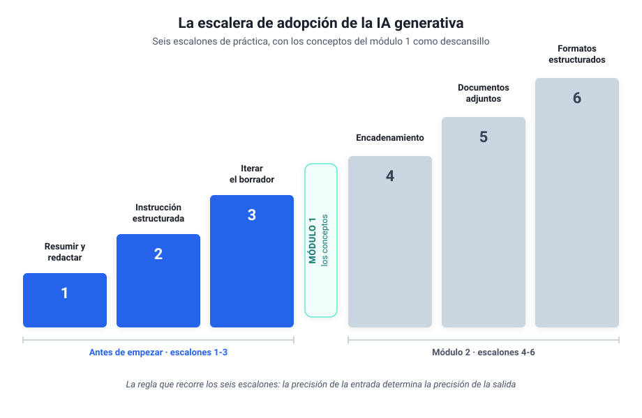

# Antes de empezar

## Los tres primeros escalones, con el chat que ya tienes

Este capítulo es para ti si alguna vez has abierto ChatGPT, has recibido una respuesta mediocre y has concluido que esto no era para tanto. La causa de esa decepción suele estar en cómo se pide, y aprender a pedir bien tiene tres pasos concretos que cualquiera puede dar en una tarde. Yo tardé dos años en interiorizarlos por la vía lenta, probando y fallando; este capítulo existe para ahorrarte ese rodeo.

Aquí no hace falta instalar nada, crear ninguna cuenta nueva ni tocar ninguna herramienta que no tengas ya. Todo se practica con el chat de IA que ya conoces (ChatGPT, Claude, Gemini o Copilot, si es lo que te da tu empresa; cualquiera vale) y con material público o tuyo. Si tu empresa trabaja con Microsoft 365, Copilot Chat te viene gratis con la cuenta de trabajo.

Una cosa más antes de pegar nada. Si tu empresa tiene una norma sobre el uso de la IA, va por delante de todo lo que leas aquí (si no sabes si existe, pregunta en informática o en recursos humanos). Con material de trabajo se usa la herramienta que te hayan dado, normalmente Copilot; la cuenta gratuita que te abras por tu cuenta vale para practicar con textos públicos, que es lo que hacemos en el primer ejercicio.

> [!tip] ¿Vale la pena pagar?
> Para aprender y para seguir el curso entero, la versión gratuita basta. Pagar (unos 20-23 € al mes) compensa cuando ya la usas a diario y en serio, porque te da más margen de uso y los modelos más capaces. Con la gratuita, eso sí, ten más cuidado con lo que pegas (el aviso del escalón 1 te dice cómo). Los detalles y los precios del momento están en el cuadro fechado del [módulo 1](modulo-1-entender-ia-generativa.md#versiones-y-precios-a-noviembre-de-2026).

---

## 1. La escalera: el mapa de la práctica

Mi propio recorrido con estas herramientas, de 2023 a hoy, siguió una secuencia que se puede dibujar como una escalera de seis escalones. Empecé pidiendo resúmenes sueltos, aprendí a estructurar las peticiones, descubrí que la primera respuesta es siempre un borrador, y solo después llegaron los pasos encadenados, los documentos adjuntos y los formatos reutilizables. La secuencia es reproducible, y este curso la recorre entera.



Este capítulo cubre los escalones 1 a 3, que se suben solo con el chat. Los escalones 4 a 6 (encadenar pasos, trabajar sobre tus documentos, pedir formatos reutilizables) se suben en el [módulo 2](modulo-2-automatizar-con-ia.md). Entre unos y otros está el descansillo del dibujo: el [módulo 1](modulo-1-entender-ia-generativa.md), con los conceptos para decidir con criterio (qué es la IA, qué modelo elegir, qué compartir con ella y cuánto cuesta). Para un principiante, la mayor parte del valor está en los tres primeros escalones: con ellos ya se trabaja distinto. La escalera trata de cómo pides, y sirve igual en cada una de las [cinco estaciones](index.md#las-cinco-estaciones-del-curso) de herramientas que recorre el curso.

> [!tip] Observación práctica
> No hace falta memorizar la escalera ni subirla de un tirón. Sirve para situarte: cuando una sección del curso te resulte avanzada, casi siempre será porque presupone un escalón que aún no has practicado. Vuelve a él y el resto encaja.

---

## 2. Escalón 1: pedirle trabajo, no respuestas

La mayoría de la gente usa el chat de IA como un buscador con frases largas: le hace preguntas y lee respuestas. Ese uso decepciona pronto, porque para preguntas generales ya existe el buscador de toda la vida. El cambio de chip del primer escalón es darle **trabajo sobre tu material**: resumir un documento largo, extraer los datos concretos de un texto, redactar un primer borrador a partir de tus notas.

Mis primeras conversaciones útiles, allá por 2023, fueron exactamente eso: pegar un documento extenso y pedir lo esencial, o pasar unas notas desordenadas y pedir un borrador decente. Sin más sofisticación, ese uso ya devuelve la inversión de tiempo, porque convierte horas de lectura y redacción mecánica en minutos de revisión.

Una petición de primer escalón se parece a esto:

```text
Resume el texto siguiente en cinco puntos, pensando en alguien que
tiene dos minutos para leerlos. Texto: [pegas aquí el documento]
```

Fíjate en que la instrucción que escribes tiene nombre propio: se llama **prompt**, así la llama todo el mundo y así la recoge el [glosario](glosario.md). De momento basta con saber que un buen prompt dice qué quieres, sobre qué material y para quién.

> [!warning] Aviso antes de pegar nada
> Lo que pegas en el chat sale de tu ordenador, y en los planes individuales el proveedor puede usarlo para mejorar sus modelos salvo que lo desactives en la configuración de privacidad. Para estos ejercicios usa material público o tuyo, y si es de trabajo, anonimízalo antes. La receta lleva treinta segundos:
>
> - Nombres de personas, empresas y proyectos, fuera: "Cliente A", "Proyecto B", "la persona X".
> - Cifras exactas, a rangos: "entre 1 y 2 millones", "unas veinte personas".
> - Fechas y lugares que identifiquen, fuera o en genérico: "el trimestre pasado", "una ciudad mediana".
>
> La regla completa de qué se puede compartir con la IA y qué no llega en el módulo 1; hasta entonces, en caso de duda, no lo pegues.

> [!example] Ejercicio 1
> Busca un texto largo que no comprometa a nadie: un informe público de tu sector, un artículo extenso de prensa, una norma que te toque leer. Pégalo en el chat (o adjúntalo, si tu chat lo permite) y pide un resumen en cinco puntos para un lector concreto (tu jefe, tu equipo, tú mismo dentro de un mes). Compara el resultado con lo que tú habrías subrayado. Ahí verás qué hace bien y qué se le escapa. Cuando quieras probar con un documento de tu trabajo, pásale antes la receta del aviso.

---

## 3. Escalón 2: la instrucción estructurada

El salto de calidad más grande de toda la escalera cuesta unas líneas más de escritura. Una petición suelta ("resume esto") produce resultados genéricos; una petición estructurada produce resultados que parecen de otra herramienta, cuando lo único que ha cambiado es la entrada. La estructura tiene seis piezas:

- **Rol**: quién quieres que sea. "Eres un asesor con experiencia en contratación pública."
- **Tarea**: qué tiene que hacer, en una frase.
- **Para quién**: quién va a leerlo y qué necesita. "Para un comité de dirección que no ha leído el informe y tiene diez minutos." Es la pieza que fija el tono.
- **Contexto**: lo que necesita saber y no está en el texto. "El cliente está molesto por el retraso del mes pasado."
- **Formato**: cómo quieres la salida. "Un correo de cuatro párrafos", "una tabla con tres columnas".
- **Restricciones**: los límites. "Máximo 200 palabras", "tono firme pero cordial", "si falta algún dato, dilo en vez de inventarlo".

En mi histórico, el salto del primer año al segundo se ve exactamente aquí. Un ejemplo que recuerdo bien: un discurso para una conferencia con un hueco de nueve a diez minutos. En vez de pedir "escríbeme un discurso", la petición fijaba el papel del ponente, el público, el mensaje central y una restricción dura de duración (a unas dos palabras y media por segundo, el texto no podía pasar de cierta longitud). El resultado necesitó retoques, por supuesto, pero salió a la primera con la medida y el tono correctos, porque la medida y el tono iban en la petición.

Un caso de mi mundo lo muestra entero: decidir si una consultora se presenta a un concurso público a partir de su pliego, el documento con las condiciones del concurso. Como el pliego es público, puedes probarlo sin riesgo. La petición suelta sería esta:

```text
Resume este pliego.
```

Esta es la misma petición con las seis piezas, lista para copiar y adaptar a tu caso:

```text
Eres un consultor que ayuda a decidir si una empresa se presenta
a un concurso público. Resume el pliego adjunto para el comité de
ofertas, gente con experiencia que no lo ha leído y que decidirá
en una reunión de diez minutos. Contexto: somos una consultora
mediana de infraestructuras y nuestra duda principal es si podemos
acreditar la solvencia técnica que piden. Formato: una tabla con
alcance, plazo, presupuesto, solvencia exigida y criterios de
valoración, y debajo los tres riesgos principales, en una frase
cada uno. Restricciones: máximo 250 palabras; indica el apartado
del pliego de donde sale cada dato; si un dato no aparece, dilo
en vez de inventarlo.
```

> [!tip] Observación práctica
> La pieza que más gente omite es la última: qué hacer si falta información. Sin esa instrucción, la IA rellena los huecos con inventos que suenan verosímiles. Añadir "si no tienes el dato, indícalo" a tus peticiones es el hábito más rentable de este capítulo, y en el [módulo 1](modulo-1-entender-ia-generativa.md) verás por qué (la trampa se llama precisión plausible).

> [!example] Ejercicio 2
> Coge un correo real que tengas pendiente de escribir y que te dé pereza: una respuesta delicada, una reclamación, una negativa. Pídeselo al chat con las seis piezas, contando la situación con nombres y cifras genéricos, como en la receta del aviso. Lee el borrador como lo que es, un borrador, y quédate con lo aprovechable. El objetivo del ejercicio es comprobar cuánto mejora la salida cuando la entrada va completa.

---

## 4. Escalón 3: la primera respuesta es un borrador

Aquí está la diferencia entre quien abandona y quien avanza. Quien abandona trata la primera respuesta como un veredicto: si sale mediocre, la herramienta no vale. Quien avanza la trata como un primer borrador y responde con crítica concreta: qué sobra, qué falta, qué está mal enfocado. La herramienta encaja esa crítica sin agotarse, las veces que haga falta.

Un caso mío, de cuando preparaba un artículo: necesitaba una pieza visual que explicara los beneficios de una metodología de trabajo. La primera propuesta era confusa; la segunda, mejor pero recargada; en cada vuelta yo explicaba qué fallaba exactamente, y a la cuarta iteración quedó claro que aquel contenido funcionaba mejor como tabla que como gráfico. Cambiamos de formato y la tabla acabó en el artículo. La iteración incluye eso: saber pedir un formato distinto cuando el elegido no funciona.

Dos peticiones de iteración que uso constantemente:

```text
Demasiado genérico. El lector es [quien sea] y le importa sobre todo
[lo que sea]. Reescribe con eso en mente.
```

```text
Tu respuesta me da la razón en todo, y eso me sirve de poco.
Dame los tres argumentos en contra más fuertes.
```

La segunda merece comentario: estas herramientas son complacientes por diseño, y pedirles explícitamente el ángulo contrario es la forma más rápida de obtener un análisis con sustancia en lugar de un eco de tu propia opinión.

> [!example] Ejercicio 3
> Recupera una conversación en la que la IA te decepcionó (o provoca una nueva con una petición floja a propósito). Itera tres veces, y en cada vuelta señala un fallo concreto: una vez el enfoque, otra el tono o el público, otra el formato. Si a la tercera iteración el resultado no es claramente mejor que el inicial, revisa qué le estás dando: casi siempre lo que falta es contexto.

---

## 5. El principio que gobierna los tres escalones

Si solo te llevas una idea de este capítulo, que sea esta: **la precisión de la entrada determina la precisión de la salida**. Cuando la respuesta es genérica, la causa suele estar en la pregunta; cuando inventa, suele ser porque le pediste recordar en vez de darle el material; cuando se equivoca de tono, casi nunca le dijiste para quién escribía. La IA solo sabe lo que le pones delante.

Esto, que dicho así parece evidente, es lo que más tardé en interiorizar de todo mi recorrido. Durante meses atribuí al modelo limitaciones que eran de mis peticiones, y el día que empecé a revisar la entrada antes de culpar a la salida, la herramienta entera cambió de categoría. Los tres escalones de este capítulo son, en el fondo, tres formas de aplicar el mismo principio.

Dentro de la entrada lo que más pesa es el material: **el contexto vale más que la instrucción**. Adjunta el archivo entero, la captura de pantalla, el documento completo, en lugar de resumírselo tú. Con el material delante la redacción exacta de la petición importa menos, y lo que más rinde es darle el contexto adecuado. El [módulo 2](modulo-2-automatizar-con-ia.md) dedica un escalón entero a adjuntar documentos.

---

## 6. Si tienes dudas

Las preguntas que siguen son las que más oigo de colegas de mi generación, y merecen respuesta directa.

> [!note]- «Tengo 55 años, ¿de verdad puedo aprender esto?»
> Los tres escalones de este capítulo no exigen ninguna destreza técnica nueva: exigen escribir con claridad y juzgar resultados, que es lo que llevas haciendo toda tu carrera. La ventaja en este terreno la da el criterio acumulado, porque la IA redacta rápido pero decidir si el resultado vale exige conocer el oficio, y eso no se aprende en seis meses de ChatGPT. Tu experiencia juega a favor, con una condición: practicar sobre material de tu sector, que es justo lo que piden los ejercicios.

> [!note]- «¿Me quedo sin trabajo?»
> Nadie puede prometerte que no, y desconfía de quien lo haga en cualquiera de los dos sentidos. Lo observable hoy es que cambian las tareas: lo mecánico (resumir, extraer, redactar primeras versiones) se delega, y la revisión con criterio vale más que antes, porque alguien tiene que responder de lo que se entrega. El riesgo más concreto a corto plazo tiene otra forma: competir con alguien de tu mismo perfil que ya delega lo tedioso y dedica las horas ganadas a lo que de verdad se paga.

> [!note]- «Mi empresa prohíbe subir datos a la nube»
> Prudente por su parte, y compatible con este curso. Para aprender no hace falta tocar ni un dato de la empresa: los ejercicios funcionan con documentos públicos, material inventado o textos pasados por la receta del escalón 1. En el módulo 1 verás la regla completa de qué se puede compartir, las opciones que no salen de tu ordenador y cómo plantear la conversación con el responsable de informática, que suele ser más receptivo de lo que se espera cuando llegas con el vocabulario correcto.

---

## Autoevaluación

> [!question] Comprueba lo que te llevas
> Respóndete a estas tres y despliega para comprobar.
>
> 1. Tu resumen sale genérico por más que lo pides. ¿En qué pieza de la instrucción estructurada suele estar el fallo?
> 2. La primera respuesta es floja. ¿Qué haces, y por qué eso separa a quien avanza de quien abandona?
> 3. La IA te suelta un dato concreto con total seguridad. ¿Qué instrucción, escrita de antemano, evita que se lo invente?

> [!note]- Soluciones
> 1. Casi siempre falta el **contexto** y el **para quién**: no le has dicho el material ni el público. El modelo responde a ciegas.
> 2. La tratas como un **borrador** y respondes con crítica concreta (el enfoque, el tono, el formato). Quien la trata como veredicto se rinde; quien la trata como borrador mejora.
> 3. Añadir **"si no tienes el dato, dilo en vez de inventarlo"**. Es el hábito más rentable del capítulo.

---

## 7. Cierre y aprendizajes clave

- **La escalera de seis escalones es el mapa de la práctica**: este capítulo sube los tres primeros y el módulo 2 retoma los otros tres.
- **Escalón 1**: la IA rinde cuando le das trabajo sobre tu material, en vez de hacerle preguntas de cultura general.
- **Escalón 2**: rol, tarea, para quién, contexto, formato y restricciones convierten una petición floja en una instrucción profesional.
- **Escalón 3**: la primera respuesta es un borrador; la crítica concreta y la petición de contraargumentos son las herramientas de mejora.
- **El principio de fondo**: la precisión de la entrada determina la precisión de la salida, y el material que adjuntas pesa más que la redacción de la petición.

> [!abstract] Resumen del capítulo
> Ya sabes pedir trabajo útil con el chat que tenías: resumir y redactar sobre material público o anonimizado, estructurar la instrucción completa e iterar con criterio.

---

Con los tres primeros escalones practicados, sigue en el [Módulo 1](modulo-1-entender-ia-generativa.md): en dos minutos sabrás qué puedes pegar en un chat y qué no, y al terminarlo tendrás elegida tu herramienta y sabrás si te compensa pagarla. Si prefieres avanzar con un plan, la [ruta de 30 días](modulo-8-caso-uso-final.md#tu-ruta-de-30-dias) te marca un hito por semana, y la primera semana empieza aquí.
