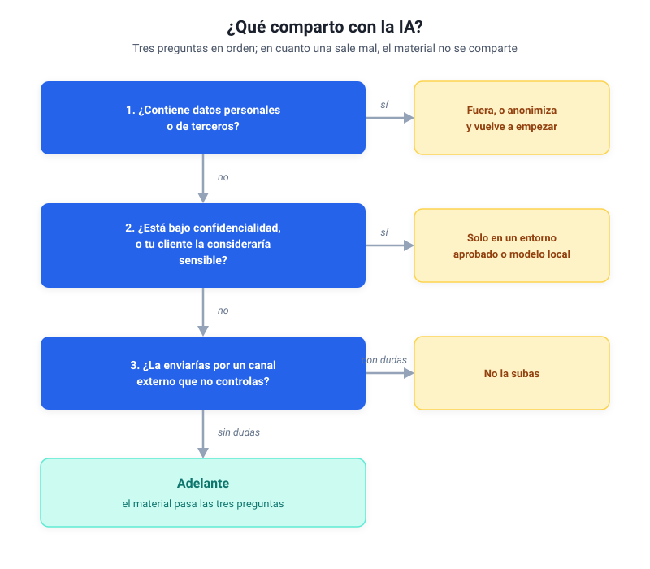

# Módulo 1 - Entender la IA generativa

## Qué puedes pegar, para qué sirve y cómo elegir

¿Qué puedes pegar en un chat de IA y qué no? ¿Y para qué sirve de verdad, más allá de contestar preguntas? Son las dudas con las que quizá llegas a este módulo, y fueron las mías. Todo lo que hoy hace por mí Paco (así, de tanto trabajar codo con codo, acabé llamando al sistema con el que trabajo cada día) empezó en ese punto exacto: yo, delante de un chat, sin tener claro cuál usar, para qué, ni qué podía escribir en él sin meter la pata.

La primera duda se resuelve con [tres preguntas](#la-decision-en-tres-preguntas) que se leen en dos minutos; si hoy no tienes más tiempo, empieza por ahí. El resto del módulo da las bases justas para **decidir con criterio**: para qué sirve la IA, qué herramienta y qué modelo elegir, cuánto cuesta y qué dice la ley. Todo lo demás se construye encima.

Si todavía no has practicado los tres primeros escalones (pedir trabajo sobre tu material, estructurar la petición, iterar), empieza por [Antes de empezar](antes-de-empezar.md); este módulo da por hecha esa base.

---

## 1. Para qué sirve (y qué no es)

La IA generativa **produce contenido nuevo** (texto, imágenes, código, audio) a partir de instrucciones escritas en tu idioma. Los modelos de lenguaje (LLM, por sus siglas en inglés) son su forma más extendida: les das una instrucción y te devuelven una respuesta elaborada. Procesan, resumen, clasifican y generan texto con rapidez, mejoran con instrucciones claras y aceleran las tareas repetitivas.

**Lo que no es:**

- No es infalible: inventa datos con seguridad aparente (lo que se llaman ["alucinaciones"](glosario.md)).
- No es una base de datos: no "sabe" lo que hay en tus archivos a menos que se lo des.
- No sustituye el criterio profesional: amplifica lo que ya sabes, pero no piensa por ti.

> [!tip] Observación práctica
> La mayoría de profesionales empiezan usando la IA como un chatbot para hacer preguntas y no pasan de ahí. Lo interesante empieza cuando dejas de usarla como buscador y empiezas a usarla como herramienta de proceso: que resuma, clasifique, extraiga y transforme la información con la que ya trabajas.

### Verificar siempre: la trampa de la precisión plausible

De todos los riesgos al usar IA, el más traicionero es el que no se ve venir. La IA te dará una cifra, una fecha, el nombre de una norma o una sigla con una seguridad impecable, y sonará tan verosímil que cuela sin que lo cuestiones. A eso se le llama **precisión plausible**, y es la forma más habitual en que la IA mete a un profesional en un problema.

Lo he visto de cerca: un informe de casi 7.000 palabras que necesitó quince correcciones, casi todas del mismo tipo. Cifras que la IA había redondeado, nombres que había atribuido mal, siglas que había expandido a su manera. Ninguna saltaba a la vista. Las cazó la revisión humana, una a una.

La defensa es cuestión de hábito, y se reduce a cuatro reflejos:

- **Exige la fuente.** "¿De dónde sale ese dato? Cítame el documento." Si no puede, trátalo como sospechoso.
- **Que copie del documento.** Cuando trabajes sobre un texto, pídele que saque los datos de lo que tiene delante, en vez de contestar de memoria, y que te diga cuándo algo no está.
- **Desconfía de lo redondo.** Una cifra exacta y bonita sin fuente es la más peligrosa de todas.
- **Pide el rango.** Si dos fuentes discrepan, que te dé las dos y diga cuál es cuál, en lugar de elegir una por ti.

> [!warning] La regla práctica
> Trata cada dato concreto que produzca la IA (una cifra, una fecha, un nombre propio, una sigla) como un borrador que tú tienes que verificar antes de firmarlo, porque la responsabilidad de que sea cierto sigue siendo tuya.

> [!note]- Profundiza: cinco errores comunes al empezar (despliega)
> - **"Uso ChatGPT para todo"** → Cada modelo tiene fortalezas distintas. Prueba al menos dos para comparar.
> - **"La IA me da siempre la razón"** → Los modelos son complacientes por diseño. Pídele explícitamente que señale errores o debilidades en tu planteamiento.
> - **"Copio el prompt de un tutorial"** → Los prompts funcionan cuando se adaptan a tu contexto. Usa las seis piezas de [Antes de empezar](antes-de-empezar.md#3-escalon-2-la-instruccion-estructurada): rol, tarea, para quién, contexto, formato y restricciones.
> - **"No sé por dónde empezar"** → Empieza por lo que más te duele: ¿qué tarea repetitiva haces cada semana que podrías delegarle a la IA?
> - **"Subo todos mis documentos al asistente"** → Menos es más. Empieza con 3-5 documentos bien seleccionados.

---

## 2. Los 4 patrones de uso

Prácticamente todo lo que puedes hacer con IA generativa en un entorno profesional se reduce a cuatro patrones:

| Patrón | Qué hace | Ejemplo |
|--------|----------|---------|
| **Resumir** | Condensa información larga en lo esencial | Correo largo del cliente → 5 puntos clave para el equipo |
| **Clasificar** | Asigna categorías o niveles a contenido | Consulta de cliente → urgente / normal / informativa |
| **Extraer** | Saca datos concretos de un texto | Contrato de 40 páginas → partes, plazos, penalizaciones |
| **Conversar** | Responde preguntas sobre un tema o documento | "¿Qué dice el procedimiento sobre las vacaciones?" |

Cuando pienses en un caso de uso, pregúntate: **¿estoy resumiendo, clasificando, extrayendo o conversando?** En cuanto le pones nombre al patrón sabes qué pedirle; lo difícil, casi siempre, es la pregunta anterior: qué tarea tuya encaja ahí.

**Ejemplos por sector** (abre el tuyo):

=== "Consultoría"
    Un informe de 30 páginas llega por correo: la IA extrae los 5 riesgos principales y los resume para el socio director.

=== "Legal"
    Un contrato nuevo: la IA extrae las cláusulas de penalización y las compara con la plantilla estándar.

=== "Marketing"
    200 respuestas a una encuesta de satisfacción: la IA clasifica por sentimiento y genera un resumen por temas.

=== "RRHH"
    Preguntas frecuentes de empleados sobre políticas internas: un asistente que conversa sobre el manual de la empresa.

=== "Finanzas"
    Informes mensuales de 15 páginas: la IA extrae los indicadores (KPI) y señala desviaciones respecto al mes anterior.

> [!note]- Profundiza: la IA que ve y escucha (despliega)
> Los cuatro patrones valen también más allá del texto escrito. Los asistentes actuales (lo que la tabla del apartado 3 llama «multimodal») pueden:
>
> - **Ver imágenes:** le pasas una foto de una pizarra con notas de una reunión y te devuelve un resumen estructurado.
> - **Procesar documentos escaneados:** un PDF con tablas escaneadas → la IA extrae los datos.
> - **Transcribir audio:** la grabación de una reunión de una hora → acta resumida en minutos.
>
> Un ejemplo de oficina: una reunión con el cliente por Teams, con la transcripción activada y los participantes avisados al empezar. Al terminar, el asistente que tu organización tenga aprobado (Copilot dentro de Teams si tenéis la licencia completa, o subiéndole la transcripción) convierte la transcripción en un acta con los puntos de acción, y antes de enviarla compruebas quién se comprometió a qué. Total: 10 minutos en vez de 45. Las dos condiciones son las que hacen bueno el ejemplo: todos saben que se transcribe, y lo hablado no sale del entorno de trabajo donde ya estaba la reunión.

---

## 3. Elegir modelo: el mapa actual

Hay varios asistentes, con capacidades, precios y políticas de privacidad distintas, y ninguno gana en todo. No hace falta memorizar ningún nombre: la tabla habla de familias, que es lo que dura, y las versiones de hoy están en el [cuadro fechado](#versiones-y-precios-a-noviembre-de-2026) del apartado 4.

La columna «Privacidad» dice si el proveedor usa lo que escribes para **entrenar**, es decir, para mejorar sus modelos futuros con tu texto; «no entrenar» significa que tu texto no se guarda con ese fin. Salvo la de Copilot, las celdas hablan de las cuentas personales; los planes de empresa no entrenan con tus datos. El criterio completo está en el [apartado 5](#5-privacidad-y-seguridad-que-puedes-compartir-con-la-ia).

| Asistente | Fortaleza | Privacidad |
|-----------|-----------|------------|
| **ChatGPT** (OpenAI) | Versatilidad general, multimodal | Puede entrenar con tus chats; se desactiva en los ajustes |
| **Claude** (Anthropic) | Análisis extenso, instrucciones complejas, código | Puede entrenar con tus chats; se desactiva en los ajustes |
| **Gemini** (Google) | Integración con Gmail y Google Drive, multimodal | Usa tus chats salvo que desactives la actividad |
| **Copilot** (Microsoft) | Vive dentro de Microsoft 365: Teams, Outlook, Word, Excel | Con cuenta de trabajo, no entrena con tus datos |
| **Vibe** (Mistral, antes Le Chat) | Opción europea, buen rendimiento | Puede entrenar con tus chats; se desactiva en los ajustes |

Fuera de la tabla quedan los **modelos locales**: modelos abiertos como Llama, Gemma, Mistral o Qwen, que corren en tu propio ordenador sin enviar nada a la nube (el detalle, en «Para los pros» del [módulo 5](modulo-5-ia-que-programa.md#para-los-pros)).

### Cómo elegir

- **Lo primero, ¿dónde viven ya tus datos y tu suscripción?** → La mejor IA suele ser la que vive ahí. ¿Tu organización usa Microsoft 365? Copilot, con tu cuenta de trabajo. ¿Tu correo y tus documentos están en Gmail y Google Drive? Gemini, sobre todo si ya pagas Google.
- **¿Necesitas máxima calidad en análisis largos?** → El modelo superior de ChatGPT o de Claude.
- **¿Buen rendimiento a bajo coste?** → El modelo intermedio de cualquiera de ellos: para la mayoría de los usos profesionales, la mejor relación entre calidad y coste.
- **¿Trabajas con datos sensibles?** → La versión de empresa que apruebe tu organización, o un modelo local.

---

## 4. ¿Cuánto cuesta esto?

La pregunta que todo el mundo se hace y casi nadie responde con cifras. Lo primero, para despejar cualquier duda: **este curso es gratuito, entero y para siempre**, los ocho módulos. Lo único que puede costar dinero son las herramientas con las que practiques; sus precios cambian a menudo, pero los órdenes de magnitud llevan años estables.

### Versiones y precios, a noviembre de 2026

> [!info] Datos comprobados el 8 de noviembre de 2026
> Versiones de hoy de cada familia:
>
> - OpenAI: familia GPT-6
> - Anthropic: familia Claude 5.5 (Opus, Sonnet y Haiku), con Fable 5.1 en lo más alto
> - Google: Gemini 4
> - Modelos abiertos: Llama, Gemma, Mistral y Qwen 3.8
>
> Precios en España, aproximados, IVA incluido, al mes:
>
> - Versiones gratuitas de ChatGPT, Claude o Gemini: 0 €
> - ChatGPT Go: unos 8 €
> - ChatGPT Plus: unos 23 €
> - Google AI Plus: unos 5 €
> - Google AI Pro: unos 22 €
> - Claude Pro: unos 22 €
> - Microsoft 365 Copilot Chat: gratis con una cuenta de trabajo de Microsoft
> - Microsoft 365 Copilot, la licencia completa: entre unos 18 y 30 € por usuario según el plan, que paga la empresa además de Microsoft 365
> - Modelos locales: 0 €
>
> Nombres y precios cambian cada pocos meses; el resto del curso no depende de ellos.

**Coste por uso.** Cuando en el [módulo 2](modulo-2-automatizar-con-ia.md) montes flujos automáticos, esa parte del trabajo deja de cubrirla la suscripción: el flujo llama al modelo directamente, por la puerta de servicio que los proveedores abren a los programas (la API, que verás en ese módulo), y paga por trabajo hecho. Resumir un informe de 30 páginas cuesta unos pocos céntimos, y mi flujo de boletines de cada mañana, menos de 50 céntimos de euro al mes. Un aviso que ahorra confusión: la suscripción de chat y esa puerta de servicio llevan cuenta y facturación separadas; pagar ChatGPT Plus o Claude Pro no incluye la credencial que usan los flujos, y al revés tampoco.

**Presupuesto orientativo para las herramientas.** Seguir el curso completo, del módulo 1 al 8, cuesta cero: se puede leer entero y hacer los ejercicios de los tres primeros módulos con las versiones gratuitas, o con Copilot si es lo que te da tu empresa. Trabajar en serio a diario justifica una suscripción de pago, unos 20-23 € al mes. Automatizar (la práctica de los módulos 2 en adelante, si decides montarla) añade esos céntimos por uso y, si tu flujo crece, el plan de pago de la plataforma; el orden de coste de esas plataformas lo verás en el módulo 2.

Una advertencia que va pegada al precio: **gratis en euros exige más cuidado con los datos**. Las versiones gratuitas suelen tener las políticas de datos menos favorables (en varios proveedores, lo que escribes puede usarse para entrenar sus modelos, salvo que lo desactives), así que con ellas practica con material público o tuyo, ya anonimizado. La sección siguiente te da el criterio completo; aquí basta con retener que el plan gratuito es perfecto para aprender y el peor sitio para pegar nada sensible.

> [!tip] Observación práctica
> Más de una suscripción de pago a la vez rara vez compensa al empezar. Prueba dos o tres herramientas en gratuito, elige la que mejor entienda tu contexto, paga esa y revisa la decisión a los tres meses, que en este mercado es una era geológica.

---

## 5. Privacidad y seguridad: qué puedes compartir con la IA

Si vas a saltarte algo de este módulo, que no sea este apartado; de aquí salen los disgustos de verdad.

> [!warning] Alerta de privacidad
> **Regla de oro:** si no lo enviarías por correo sin cifrar a un desconocido, no se lo des a una IA en la nube.

> [!note]- Profundiza: lo que suele poder compartirse y lo que no (despliega)
> **Lo que SÍ puedes compartir**
>
> - Textos genéricos sin datos personales.
> - Procedimientos internos ya publicados o públicos.
> - Datos anonimizados o sintéticos.
> - Borradores propios para revisión.
>
> **Lo que NO debes compartir**
>
> - Datos personales (nombres + DNI, teléfonos, direcciones).
> - Información financiera sensible de clientes.
> - Contratos con cláusulas de confidencialidad.
> - Datos de terceros que tu organización no tiene derecho a procesar fuera de su entorno.
> - Credenciales, contraseñas o claves de acceso.

### La decisión en tres preguntas

En muchas empresas esta decisión ya la ha tomado alguien por ti: hay una norma sobre el uso de la IA y una herramienta aprobada, y con el material de trabajo se usa esa herramienta. Las tres preguntas de abajo son para lo que la norma no cubre, y para quien no tiene ninguna.

Con material concreto entre manos la regla entera cabe en tres preguntas que se hacen en orden; en cuanto una sale mal, ese material no se comparte:

1. **¿Contiene datos personales o de terceros?** Nombres con DNI, teléfonos, datos de clientes. Si sí: fuera, o anonimiza primero y vuelve a empezar por la pregunta 1.
2. **¿Está bajo confidencialidad, o tu cliente la consideraría sensible?** Contratos con cláusulas, información financiera, material de proyecto. Si sí: solo en un entorno aprobado por tu organización o en un modelo local.
3. **¿La enviarías por un canal externo que no controlas?** Si la respuesta te hace dudar, no la subas.

Si el material pasa las tres preguntas, adelante.

El entorno aprobado de la segunda pregunta suele ser una versión de empresa: ChatGPT Business o Enterprise, Claude Team o Enterprise, o Copilot con tu cuenta de trabajo. Ninguna entrena con los datos de sus clientes. Un plan individual, aunque lo pagues, puede entrenar con tus chats salvo que lo desactives.

Y dentro de ese entorno, una costumbre que conviene adoptar desde el primer día: **un proyecto o una conversación por cliente o por asunto**, para que la IA no mezcle el documento de un cliente con el caso parecido de otro.

### ¿Y si tu empresa no permite la nube?

La prohibición suele ser más razonable de lo que parece desde fuera: quien la impone responde de los datos de los clientes. Ahora bien, prohibir la nube y renunciar a la IA son cosas distintas, y conviene conocer las tres salidas antes de dar el tema por cerrado:

1. **Aprender no toca datos de empresa.** Todo lo que practica este curso funciona con documentos públicos, material inventado o textos anonimizados.
2. **Modelos locales.** Programas como Ollama o LM Studio ejecutan el modelo entero en tu ordenador: nada de lo que escribes sale de tu máquina, ni siquiera hay conexión de por medio. Rinden por debajo de los grandes modelos en nube, y aun así sobran para resumir, clasificar y extraer. Hay que instalarlos, así que en un ordenador de empresa también pasan por informática.
3. **Versiones de empresa.** Las que acabas de ver, con los controles que pide el departamento de informática. Si tu organización trabaja con Microsoft 365, Copilot con tu cuenta de trabajo puede estar ya a tu alcance sin instalar nada.

**Cómo plantear la conversación con informática.** La diferencia entre un sí y un no suele estar en llegar con un caso de uso concreto y las palabras correctas, en vez de una petición vaga de "usar IA". Algo así:

> "Quiero usar IA para resumir documentación interna. ¿Qué herramienta tenemos aprobada? ¿Puedo usar Copilot con mi cuenta de trabajo? Si no, ¿podemos valorar una versión de empresa que no entrene con nuestros datos, o un modelo local para empezar?"

Con eso el responsable de informática tiene opciones concretas que evaluar y un interlocutor que ha hecho los deberes. La conversación cambia de tono, y si tu organización aún no tiene una política de IA, es buen momento para proponerla.

---

## 6. El marco legal: el Reglamento europeo de IA

Desde 2024 la Unión Europea regula la IA con un reglamento propio que ordena sus usos por niveles de riesgo: a más riesgo para las personas, más obligaciones, hasta prohibir algunas prácticas. Como profesional que la usa en tu trabajo, hoy te afectan dos cosas: tu organización debe poner medios para que aprendas a usarla (el artículo 4, un buen argumento si quieres pedir horas para formarte), y quien habla con una IA tiene que saberlo. Lo personal que pegues en un chat sigue bajo la protección de datos de siempre (el RGPD europeo y la ley española, la LOPDGDD), que es justo lo que vigila la primera de las tres preguntas.

> [!note]- Profundiza: el calendario y quién vigila (despliega)
> - Agosto de 2024: entra en vigor el Reglamento (UE) 2024/1689, con obligaciones que se aplican por etapas.
> - Febrero de 2025: quedan prohibidas ciertas prácticas, y las organizaciones que usan IA deben ocuparse de la alfabetización en IA de su personal (artículo 4; desde julio de 2026, tras el paquete Ómnibus, la obligación es poner medidas que la fomenten, sin garantizar un nivel concreto).
> - Agosto de 2026: empiezan las obligaciones de transparencia, como que la gente sepa cuándo habla con una IA o que ciertos contenidos generados vayan etiquetados.
> - Diciembre de 2027 y agosto de 2028: las obligaciones de los usos de alto riesgo, que el paquete Ómnibus Digital, aprobado en julio de 2026, aplazó a esas dos fechas.
>
> En España supervisa la AESIA (Agencia Española de Supervisión de Inteligencia Artificial), y una ley española de IA está en tramitación en el Congreso. El RGPD y la LOPDGDD siguen aplicándose a todo dato personal, con IA o sin ella.

Una duda que surge enseguida es si hay que avisar de que un texto lo ha preparado la IA. El Reglamento obliga a marcar sobre todo lo que puede engañar: imágenes, audio o vídeo que imitan la realidad, y los textos generados que se publican para informar al público sin que nadie los haya revisado y responda de ellos. Un informe o un correo que revisas y firmas tú queda, en general, fuera de esa obligación. Lo que sí puede obligarte es tu empresa o tu cliente, porque hay políticas internas y contratos que piden declarar el uso de IA; conviene mirarlo antes de entregar.

---

## 7. Conectar la IA con tu correo y tus documentos

Tarde o temprano querrás que la IA lea tu correo, tu calendario o una carpeta de documentos sin copiar y pegar: es la tercera de las [cinco estaciones](index.md#las-cinco-estaciones-del-curso) del curso, y el [módulo 5](modulo-5-ia-que-programa.md) la recorre con calma. Para conectar hay dos vías.

La habitual es **la de un clic**: un complemento que se añade desde la propia aplicación (Outlook y Word tienen los suyos), un conector que el asistente ya trae de serie o un botón de «autorizar con tu cuenta» de Microsoft o de Google, sin nada que guardar. El criterio sigue siendo tuyo: autorizar el acceso al correo da acceso a todo el buzón, y con datos de la empresa ese permiso pasa por informática, y así debe ser.

La otra es **la credencial**, y solo aparece cuando automatizas, cuando un programa llama al modelo por su cuenta sin ti delante del chat. Es la llave de la puerta de servicio del apartado 4: un código largo que se genera en el panel del proveedor, se pega una vez en la herramienta y no se comparte por correo ni por chat. La usarás en el [módulo 2](modulo-2-automatizar-con-ia.md) si montas tu primer flujo.

> [!note]- Profundiza: cuenta, credencial y conexión (despliega)
> Son tres conceptos que confunden a todo el mundo cuando empieza a conectar herramientas:
>
> | Concepto | Qué es | Analogía |
> |----------|--------|----------|
> | **Cuenta** | Tu identidad en un servicio (Microsoft, Google, OpenAI) | "Soy yo" |
> | **Credencial** | Un código que autoriza a un programa a usar un servicio en tu nombre | "Esta es mi llave" |
> | **Conexión** | El permiso o la credencial que una herramienta guarda para usarlos en tus flujos | "Guarda mi llave para no tener que sacarla cada vez" |
>
> En la práctica la mayoría de los atascos están en las credenciales. "No funciona" suele significar "no hay credencial" o "la cuenta no tiene permisos". Antes de pensar que la IA falla, revisa que la llave esté en su sitio.

---

## 8. Aplícalo

> [!example] Aplícalo
> Piensa en una tarea repetitiva de tu semana que te robe tiempo: leer correos largos, clasificar consultas que entran, sacar datos de informes. Ponle nombre con uno de los cuatro patrones: ¿estás resumiendo, clasificando, extrayendo o conversando? Después abre dos asistentes distintos (por ejemplo Claude y ChatGPT, o Copilot si es el que te da tu empresa; si solo tienes cuenta en uno, crear otra en versión gratuita lleva dos minutos, un correo y una contraseña), dales la misma tarea con material que pase las tres preguntas (un texto público, o uno tuyo ya anonimizado) y compara las respuestas. Quédate con el que mejor entienda tu contexto. Ese pequeño experimento te enseña más que cualquier tabla comparativa.

---

## Autoevaluación

> [!question] Comprueba lo que te llevas
> Respóndete y despliega para comprobar. Del 3 al 6 son casos límite: pasa cada uno por las tres preguntas de privacidad y decide si va tal cual, anonimizado, solo al entorno aprobado o a ninguna parte.
>
> 1. "Sacar las cláusulas de penalización de un contrato de 40 páginas" es uno de los cuatro patrones. ¿Cuál?
> 2. Pagas ChatGPT Plus. ¿Incluye eso la credencial que usará un flujo automático?
> 3. El pliego de una licitación pública que quieres resumir antes de decidir si os presentáis.
> 4. El correo de un cliente con una consulta técnica y su firma completa: nombre, cargo y móvil.
> 5. El borrador de tu oferta para ese cliente, con su nombre y el precio que vais a presentar.
> 6. Una captura de tu bandeja de entrada, para que la IA te ayude a decidir qué contestar primero.

> [!note]- Soluciones
> 1. **Extraer**: sacas datos concretos de un texto.
> 2. **No**: la suscripción de chat y el acceso de los programas al modelo son cuentas y facturación separadas. Una no incluye la otra.
> 3. **Tal cual**: es un documento publicado y pasa las tres preguntas, incluso en una versión gratuita.
> 4. **Anonimizado**: la firma hace fallar la primera pregunta. Quita nombre, cargo y móvil, cambia la empresa por "Cliente A" y la consulta técnica pasa las tres.
> 5. **Solo en el entorno aprobado**, o en un modelo local: aunque cambies el nombre del cliente, el precio de una oferta sin presentar es información confidencial y falla la segunda pregunta.
> 6. **Recortada, o a ninguna parte**: una imagen lleva datos igual que un texto, y en la captura se ven nombres y asuntos de otras personas, así que falla la primera pregunta. Recorta lo que identifique a otros, o cuéntale la situación con tus palabras.

---

## 9. Cierre y aprendizajes clave

- La IA generativa es **una herramienta de proceso que necesita instrucciones claras**: tratarla como un buscador o un oráculo es la vía rápida a la decepción.
- Todo lo que harás con IA se reduce a **4 patrones**: resumir, clasificar, extraer, conversar.
- **La mejor IA suele ser la que vive donde ya viven tus datos**; después, elegir modelo es elegir entre calidad, coste y privacidad.
- **El coste tiene órdenes de magnitud conocidos**: gratuito para aprender, unos 20-23 € al mes para trabajar en serio, céntimos por documento cuando automatices.
- **La privacidad cabe en tres preguntas**, y si tu empresa no permite la nube hay tres salidas concretas que plantearle a informática.
- **Conectar suele ser cosa de un clic**; la credencial solo aparece cuando automatizas.

> [!abstract] Resumen del módulo
> Ya puedes identificar los patrones de uso de la IA, elegir una herramienta y un modelo adecuados para tu contexto, evaluar los riesgos de privacidad y el marco legal, y conectar tus primeras herramientas con criterio. Con eso puedes pasar al módulo 2, donde empieza la práctica de encadenar y adjuntar.

---

> [!info] Para profundizar
> - [Intro to Large Language Models](https://www.youtube.com/watch?v=zjkBMFhNj_g): Andrej Karpathy explica en una hora cómo funcionan los modelos de lenguaje sin requerir conocimientos técnicos.
> - [How to use AI to do practical stuff](https://www.oneusefulthing.org/p/how-to-use-ai-to-do-practical-stuff): guía del profesor Ethan Mollick (Wharton) con casos de uso concretos.
> - [Generative AI for Everyone](https://www.deeplearning.ai/courses/generative-ai-for-everyone/): curso gratuito de Andrew Ng que cubre los fundamentos para audiencias no técnicas.
> - [Artificial Analysis: Comparador de modelos](https://artificialanalysis.ai/models): comparativa independiente de modelos por precio, velocidad y calidad.
> - [Ollama](https://ollama.com/): ejecuta modelos de IA en tu máquina, sin enviar datos a terceros.

---

En el [Módulo 2](modulo-2-automatizar-con-ia.md) retomas los escalones donde los dejaste: encadenar pasos, trabajar sobre documentos adjuntos y, cuando el chat se quede corto, montar tu primer flujo automático (entrada de datos → IA procesa → resultado útil para tu equipo).
