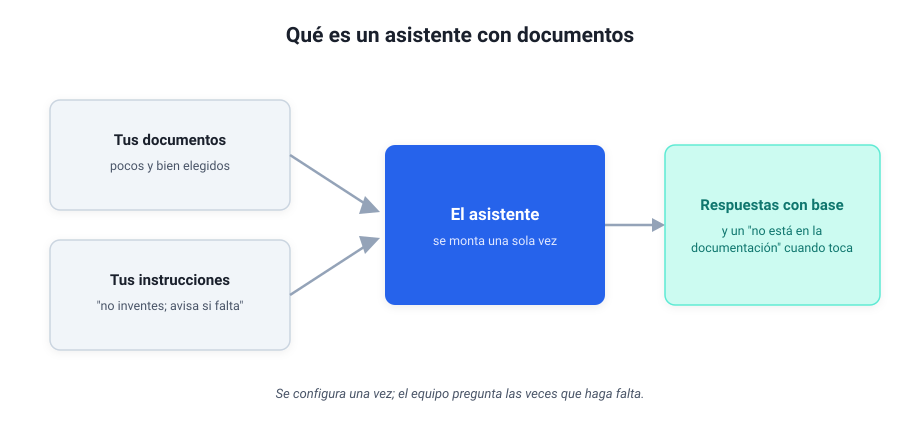

# Módulo 3 - Asistentes con documentos

## Crear asistentes propios que responden sobre tu información

En el escalón 5 del [módulo anterior](modulo-2-automatizar-con-ia.md) aprendiste a adjuntar un documento para que la IA trabaje sobre él. Este módulo convierte ese escalón en algo permanente: en vez de subir el documento cada vez, montas una sola vez **un asistente que ya tiene tu documentación**, sin poner en riesgo información sensible, y le preguntas las veces que haga falta.

Es la segunda estación del recorrido de herramientas del curso (el chat, el chat con tus documentos, el chat conectado a tu correo y tus carpetas, el agente de escritorio y, si quieres, el terminal), y para muchos lectores será, con razón, la de llegada. Yo mismo trabajé así, y mucho, hasta descubrir Claude Code, el asistente de código del [módulo 5](modulo-5-ia-que-programa.md). Cuando quieras que la IA lea directamente tu correo y tus carpetas, el paso natural son los conectores de ese mismo módulo.

---

## 1. Qué es un asistente con documentos (y qué no es)

**Es:**

- Un asistente que tiene acceso a documentos que tú le indicas.
- Un asistente con instrucciones de comportamiento ("responde breve", "cita el documento").
- Un punto único de consulta para tu equipo sobre procedimientos, políticas o proyectos.

**No es:**

- Un reemplazo de tu gestor documental.
- Una garantía contra las invenciones: si algo no está en los documentos, puede inventarlo.
- Público por defecto: depende de cómo lo compartas.

Se parece más a un **documento interactivo** que a un chatbot genérico.



---

## 2. Los constructores principales

Hoy existen varios entornos para crear asistentes con documentos sin programar. Los tres primeros funcionan con una cuenta personal; el cuarto, si tu empresa te da Copilot:

| Constructor | Ventaja | Limitación |
|-------------|---------|------------|
| **Proyectos** de ChatGPT | El más extendido; sustituyen a los antiguos GPTs, que OpenAI está retirando | Datos en nube de OpenAI |
| **Claude Projects** | Excelente para documentos largos | Menos integraciones que OpenAI |
| **Gems** de Gemini | Integración directa con Google Workspace | Menor control sobre instrucciones |
| **Agentes de Copilot** (Microsoft 365) | Se montan sobre tus documentos de SharePoint u OneDrive | Sobre documentos de la empresa piden la licencia completa o el pago por uso que active informática |

Los cuatro funcionan con el mismo principio: subes (o señalas) los documentos, escribes unas [instrucciones de sistema](glosario.md) (las normas fijas que rigen todas sus respuestas) y el asistente responde basándose en ese material.

Los proyectos de ChatGPT y de Claude y los Gems de Gemini se crean también con la cuenta gratuita, con límites de archivos y de número; los planes de pago dan más margen (los precios, en el [cuadro del módulo 1](modulo-1-entender-ia-generativa.md#versiones-y-precios-a-noviembre-de-2026)), y montar el asistente no añade coste sobre la suscripción. El ejercicio de este módulo sale también con Gemini Notebook (el desplegable de más abajo) o subiendo los documentos al chat de Copilot, si tu empresa te lo da. Para documentos de trabajo el sitio natural son los planes de empresa (ChatGPT Business o Enterprise, Claude Team o Enterprise, Copilot con tu cuenta de trabajo), que no entrenan con los datos de sus clientes; si tu empresa ya tiene uno, empieza por ahí.

> [!tip] Observación práctica
> Yo tengo montado un Claude Project sobre mi propia documentación de proyectos: le he subido procedimientos, actas y fichas, y le pregunto en lenguaje natural cosas que antes me obligaban a abrir diez archivos. Eso sí, en los planes individuales comprueba en los ajustes de privacidad que tienes desactivado el uso de tus chats para entrenar, como en cualquier otro proveedor. Vale la pena probar al menos dos plataformas antes de decidir.

> [!note]- Profundiza: Gemini Notebook (antes NotebookLM), gratis para estudiar un conjunto cerrado de documentos (despliega)
> Google tiene una herramienta gratuita pensada justo para esto, que nació como NotebookLM y desde julio de 2026 se llama Gemini Notebook. Le subes un conjunto cerrado de documentos (los pliegos de un concurso, la normativa de un tema, el material de un curso) y trabaja solo sobre ellos. Sirve sobre todo para tres cosas: estudiar ese material preguntándole, sacar resúmenes con citas al documento de origen y generar resúmenes en audio para escucharlos. Que sea gratuita pide más cuidado con lo que subes: material público o anonimizado, pasado por las tres preguntas del módulo 1.

---

## 3. Cómo construir uno paso a paso

Los pasos valen para cualquiera de los constructores:

### Paso 1: define el propósito

Sé específico. En vez de "un asistente de mi empresa", algo como:

- "Eres un asistente para el departamento de operaciones."
- "Respondes preguntas sobre el manual de contratación."

### Paso 2: selecciona y sube los documentos

- PDF, Word, FAQs, procedimientos.
- Mejor **pocos y relevantes** que muchos y desordenados: con demasiados, la IA a veces tira del documento menos pertinente. Si son muchos PDF cortos del mismo tema, fúndelos en uno antes de subirlos (Acrobat lo hace si tu empresa lo tiene; si no, pregunta a informática qué herramienta tenéis): la IA maneja mejor pocos archivos grandes.
- Pon nombres claros, del tipo `2025-03-01 Procedimiento de vacaciones.pdf`; un `docfinal2.pdf` no le dice nada a nadie.

### Paso 3: escribe las instrucciones del sistema

Aquí mandas tú. Un bloque que suele funcionar bien:

```text
Rol: Eres un asistente interno para personal no técnico.
Fuente: Responde únicamente con la información de los documentos proporcionados; no inventes procedimientos ni datos.
Si falta información: Di "No está en la documentación" y sugiere el documento más cercano.
Citas: En cada respuesta, indica el documento y el apartado de donde sale.
Estilo: Español profesional, máximo 120 palabras, estructurado en lista corta.
Idioma: Responde siempre en el idioma de la pregunta.
```

La línea de las citas es la que te deja comprobar cada respuesta: sin documento y apartado, no hay forma de saber de dónde sale.

### Paso 4: prueba con preguntas reales

Pregunta lo que preguntaría tu equipo:

- "¿Qué plazo tiene el cliente para reclamar?"
- "¿Qué documento hay que enviar primero?"
- "¿Cuál es el procedimiento de aprobación?"

### Paso 5: decide cómo compartirlo

- Solo para ti (experimentación).
- Con el equipo (enlace interno).
- Público (ojo: revisa qué documentos subiste).

> [!note]- Profundiza: dos costumbres de un equipo que ya trabaja así (despliega)
> Las dos salen de la práctica con proyectos y mejoran el resultado sin coste:
>
> 1. Usar el proyecto para extraer y un chat limpio para redactar. Dentro del proyecto todas las respuestas quedan condicionadas por sus documentos, lo que ayuda a buscar datos y sesga la redacción. Pregunta a las fuentes en el proyecto y apunta lo importante; para escribir, abre un chat aparte, fuera del proyecto, pega solo lo extraído y da tus instrucciones de rol, enfoque y estilo.
> 2. Usar tus propios documentos como referencia de estilo. Sube un par de trabajos tuyos anteriores y pide "adapta este texto al estilo de estos documentos, con un vocabulario parecido". Esa instrucción, y las demás que repites, merecen una biblioteca personal de contextos (el estilo de un informe técnico, el de una carta a un cliente público) que pegas cuando hace falta o dejas fija en el proyecto.

---

## 4. Privacidad: qué no subir y a quién preguntar

> [!warning] Alerta de privacidad
> No todo lo que tienes que consultar se puede subir a un asistente, aunque la herramienta lo permita.
>
> **Evita subir:**
>
> - Listados con datos personales (DNI, teléfonos, direcciones).
> - Información financiera sensible de clientes.
> - Contratos con cláusulas de confidencialidad.
> - Datos de terceros que tu organización no tiene derecho a procesar fuera de su entorno.
>
> **Regla simple:** si el documento no podrías enviarlo por un canal externo no controlado, no lo subas al asistente.

A lo anterior se añaden tres comprobaciones:

- Revisa si el proveedor usa los datos para entrenar. Si es así y no tienes autorización, no lo subas.
- Mantén una carpeta "apta para IA" con documentos ya filtrados.
- Revisa las opciones de quién puede ver/usar el asistente.

### Con documentos internos, pregunta antes a informática

La conversación con informática va antes de subir nada, y funciona mejor como pregunta. Algo así:

> "Quiero montar un asistente que responda a las preguntas del equipo de operaciones sobre tres procedimientos internos. ¿Qué herramienta aprobada tenemos para esto? ¿Podemos usar lo que ya tenemos, Copilot por ejemplo?"

Con eso el técnico sabe qué quieres hacer, con qué documentos y para quién, y puede responderte con una herramienta concreta.

---

## 5. Lista de comprobación de seguridad antes de compartir

Marca cada punto antes de compartir un asistente (el curso recuerda lo que marques):

- [ ] He revisado los documentos y no contienen datos sensibles.
- [ ] Sus instrucciones le dicen qué hacer si la información no está y le piden citar documento y apartado.
- [ ] Sé exactamente con quién lo voy a compartir.
- [ ] He probado preguntas reales del equipo.
- [ ] He documentado (aunque sea en 5 líneas) qué hace este asistente y qué documentos usa.

Si marcas todo, ya tienes algo enseñable a tu organización.

---

## 6. Errores comunes

- **"Si lo subo ya está actualizado."** → No. Si cambias el procedimiento, tienes que volver a subir el documento.
- **"Quiero que haga de todo."** → Mezclar demasiadas funciones lo vuelve impredecible. Mejor asistentes acotados.

---

## 7. Aplícalo

> [!example] Aplícalo
> Elige un tema sobre el que tu equipo te pregunta una y otra vez: un procedimiento interno, la política de gastos, las preguntas frecuentes de un producto. Reúne tres o cuatro documentos buenos sobre ese tema (los justos, bien nombrados, y que pasen las tres preguntas de privacidad del módulo 1; si son internos, con el visto bueno de informática), crea un asistente en el constructor que tengas a mano y dale las instrucciones del paso 3. Después viene la parte que casi todo el mundo se salta, y la única que te dice si el asistente sirve: **evalúalo**. Escribe cinco preguntas reales del equipo cuya respuesta tú ya conoces, házselas, y puntúa cada respuesta con tres comprobaciones: ¿respondió desde los documentos, con su cita?, ¿la respuesta coincide con la que tú sabías?, ¿dijo "no está en la documentación" cuando tocaba? Cinco de cinco: ya tienes algo que enseñar. Menos de eso: revisa qué documento falta o qué instrucción se queda corta, y vuelve a pasar la prueba.

---

## Autoevaluación

> [!question] Comprueba lo que te llevas
> Respóndete a estas tres y despliega para comprobar.
>
> 1. ¿Qué instrucción evita que el asistente improvise cuando algo no está en los documentos?
> 2. Tienes 50 documentos sobre el tema. ¿Los subes todos? ¿Por qué?
> 3. ¿Cómo compruebas de verdad que el asistente funciona, más allá de que "responda"?

> [!note]- Soluciones
> 1. Decirle explícitamente que responda **"no está en la documentación"** cuando falte, en vez de rellenar el hueco.
> 2. **No**: mejor pocos y relevantes. Con muchos, la IA a veces se va al documento menos pertinente.
> 3. Con **cinco preguntas cuya respuesta ya conoces**: ¿respondió desde el documento, con su cita?, ¿coincide con lo que sabías?, ¿avisó cuando la información no estaba?

---

## 8. Cierre y aprendizajes clave

- **Ya sabes crear un asistente con tus propios documentos sin programar.**
- Lo que decide el resultado es la **selección de documentos y unas instrucciones claras**, con cita de documento y apartado.
- La seguridad empieza por **no subir lo que no debes**, preguntar antes a informática si hay documentos internos y compartir solo con quien lo necesita.
- Es la segunda estación del curso, y puede ser la tuya de llegada; el paso siguiente es ordenar tus documentos (módulo 4) y, después, los conectores del módulo 5.

> [!abstract] Resumen del módulo
> Puedes crear un asistente que responda sobre tus documentos, sabes qué documentos puedes subir y cuáles no, qué instrucciones darle para que cite y avise cuando algo falta, y cómo preguntar antes a informática.

---

> [!info] Para profundizar
> - [Guía de prompts de OpenAI](https://developers.openai.com/api/docs/guides/prompt-engineering): guía oficial para escribir buenas instrucciones, también para los asistentes.
> - [Claude Projects: Anthropic](https://support.claude.com/en/articles/9517075-what-are-projects): documentación de Claude Projects para crear asistentes con documentos propios.
> - [Gemini Gems: Google](https://gemini.google.com/): asistentes personalizados integrados con Google Workspace.
> - [Data Privacy and ChatGPT: OpenAI](https://help.openai.com/en/articles/7039943-how-openai-handles-data-in-consumer-services): FAQ sobre cómo OpenAI usa los datos y cómo desactivar el entrenamiento.
> - [Prototype AI-powered Apps with Claude Artifacts](https://academy.claude.com/tutorials/build-custom-artifacts-with-claude): guía para crear pequeñas aplicaciones con IA dentro de Claude, sin configurar nada técnico.

---

Todo lo de este módulo depende de algo que ninguna IA controla: cómo están tus propios documentos. En el [Módulo 4](modulo-4-tus-datos-importan-mas.md) vemos por qué su orden y su formato importan más que la IA que elijas, y cómo guardarlos para que te sirvan con cualquiera.
