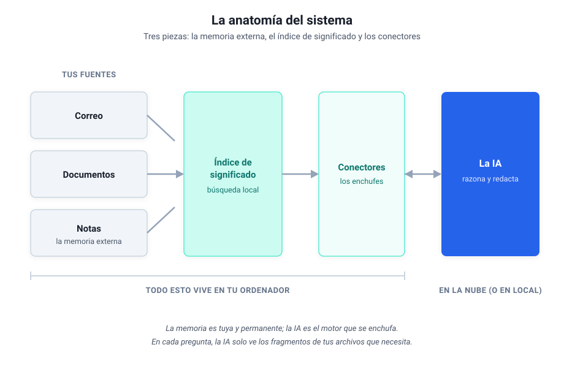
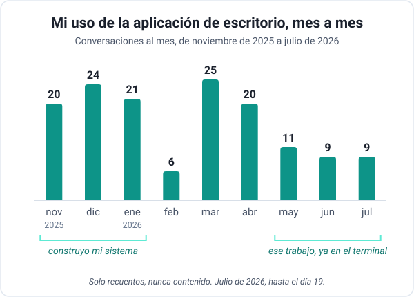
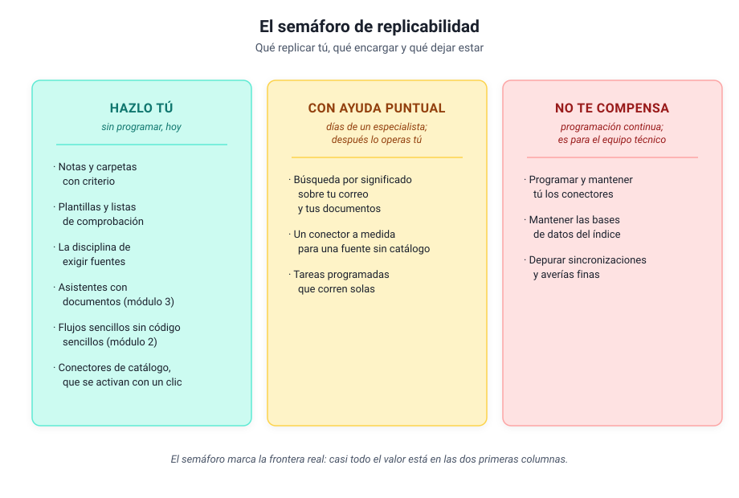

# Módulo 6 - Mirar dentro de un sistema real

## La disección guiada de mi sistema, para construir o para encargar

> [!note] Este módulo es una profundización opcional
> Todo lo que necesitas para trabajar con IA ya lo cubrieron los módulos anteriores. En el [módulo 5](modulo-5-ia-que-programa.md) viste desde fuera el sistema que uso a diario; aquí le abrimos el capó, sin construir nada. El que quiera construir encontrará el mapa; el que no, saldrá sabiendo qué pedir, a quién y con qué palabras, que es exactamente lo que necesita un directivo.

---

## 1. El plano general

Ya ha asomado su nombre en los módulos anteriores: a mi sistema lo llamo Paco. Reducido a su esqueleto, Paco tiene tres piezas: una **memoria externa** (mis notas y documentos, que viven en archivos normales en mi ordenador), un **índice de significado** (lo que me permite buscar en todo eso por el sentido de lo que pregunto) y unos **conectores** (los enchufes que dejan que la IA lea mi correo, mis documentos y mis notas cuando se lo pido). La IA es el motor que razona y redacta; todo lo demás es mío y se queda en mi máquina.

Esa forma tiene su razón. La IA trae de fábrica una memoria enorme y comprimida: lo que aprendió al entrenarse, que es mucho sobre el mundo y nada sobre tu negocio. Meterle tu conocimiento (tus proyectos, tus clientes, tu correo) a base de reentrenarla es carísimo y lento; lo práctico es dárselo desde fuera, en el momento en que lo necesita, y eso hacen las tres piezas del dibujo. Mi sistema entero está montado para que la IA tenga a mano lo mío (mis proyectos, mi correo, mis notas) en el momento en que se lo pido, sin tener que enseñárselo de antemano.

---

## 2. La memoria externa: notas que sobreviven a las herramientas

La base de todo son mis notas: miles de archivos de texto plano, organizados en carpetas con un criterio estable (proyectos activos, áreas permanentes, material de referencia, archivo). La decisión importante fue de formato: **archivos de texto normales, legibles por cualquier programa, hoy y dentro de veinte años**. Por qué esa decisión pesa más que la IA que elijas lo cuenta el [módulo 4](modulo-4-tus-datos-importan-mas.md).

¿Y cómo usa la IA esa memoria? Aquí ayuda una analogía que aprendí estudiando cómo se diseñan estos sistemas: la IA tiene una memoria de trabajo pequeña (la conversación en curso, que se llena enseguida) y trabaja como trabajamos nosotros con un **cuaderno externo**: apunta lo que conviene recordar y relee lo apuntado cuando lo necesita. Mis notas son ese cuaderno. La IA no las "sabe": las consulta, igual que tú consultas tu archivador, y por eso la memoria puede crecer sin límite mientras la conversación sigue siendo ligera.

De las tres piezas, esta es la más replicable: no requiere programar nada, solo criterio y constancia. En una oficina con Microsoft 365 toma otra forma igual de válida: **una carpeta de SharePoint bien ordenada**, con nombres claros y una sola versión válida de cada documento. Las dos sirven aunque nunca conectes una IA, y el día que la conectes, el trabajo estará hecho.

---

## 3. La búsqueda por significado

El problema que resuelve esta pieza lo has vivido: buscas "vacaciones" y el documento decía "días libres", y la búsqueda clásica no lo encuentra porque solo compara las letras que tecleas con las que hay en el documento. A escala de una carpeta es una molestia; a escala de años de correo y documentos es conocimiento perdido. Yo me hacía preguntas cuya respuesta estaba en mi propio archivo y no aparecía, porque yo no recordaba las palabras exactas con que la había escrito.

La solución se entiende sin matemáticas. Cada fragmento de texto se convierte en una **huella de significado**: una lista larga de números que resume de qué habla, calculada por un modelo de IA. Dos textos que hablan de lo mismo con palabras distintas producen huellas parecidas. Buscar deja de ser "encuentra esta palabra" y pasa a ser "encuentra las huellas que se parecen a la de mi pregunta".

Sobre esa búsqueda se monta el patrón que ya conoces del módulo 3 con otro nombre: la IA **primero busca en tu material y después redacta con lo encontrado delante**, citando de dónde lo sacó, y por eso responde sobre lo tuyo sin inventar tanto. En mi sistema el índice reúne el correo, los documentos y las notas, cientos de miles de fragmentos, todo en local: la pregunta "¿qué sé yo de este tema?" se responde en segundos contra años de material propio.

> [!note]- Profundiza: los nombres técnicos, y en qué se diferencia esto del módulo 3 (despliega)
> La huella tiene nombre técnico, *embedding*, y el almacén donde se guardan también, *base vectorial*; los dos están en el [glosario](glosario.md) y con saber que existen basta.
>
> Los asistentes con documentos del módulo 3 hacen exactamente esto por dentro, a pequeña escala y gestionado por el proveedor: subes veinte documentos y la plataforma los trocea, calcula las huellas y busca por ti. Construir la búsqueda propia tiene sentido cuando el volumen es grande (años de correo, miles de documentos), cuando el material no puede salir de tu máquina, o cuando quieres conectarla con tus propias herramientas. Es la misma idea con la propiedad y el control cambiados de sitio.

---

## 4. Los conectores: los enchufes

La tercera pieza responde a la pregunta más práctica: ¿cómo lee la IA mi correo, si el correo está en mi ordenador y la IA no? Con los conectores del [módulo 5](modulo-5-ia-que-programa.md), pequeños programas que exponen herramientas concretas ("busca correos de este remitente", "lee esta nota", "busca por significado") siguiendo un estándar común (técnicamente, MCP). La IA pide; el conector ejecuta y devuelve solo el resultado.

En mi sistema hay tres, uno por fuente (correo, documentos y notas), y corren en mi máquina. Tú no necesitas construirlos: los asistentes traen conectores de catálogo que hoy se activan con un clic. Si tu empresa vive en Microsoft 365, tienes dos vías cortas: Copilot con la licencia completa de Microsoft 365, que busca en tu correo, tu SharePoint y tu OneDrive (el Copilot Chat gratuito trabaja sobre todo con lo que le subes y, en Outlook, con parte de tu buzón; pregunta a informática qué licencia tenéis), o los conectores de Microsoft 365 del asistente que tu empresa haya aprobado.

La consecuencia de esta arquitectura es la que más tranquiliza a un responsable de informática: **el archivo se queda donde está**. No hay una copia de mi archivo en la nube del proveedor; pregunta a pregunta, la IA recibe los fragmentos justos que el conector le sirve, y esos fragmentos sí viajan hasta el modelo cuando responde.

A lo que viaja se le aplican las tres preguntas del [módulo 1](modulo-1-entender-ia-generativa.md#la-decision-en-tres-preguntas), igual que en un chat. Y si parte de tu material no puede salir ni en fragmentos, el dibujo no cambia: el motor también puede correr en tu ordenador, con los modelos locales del [módulo 5](modulo-5-ia-que-programa.md), y entonces nada abandona tu máquina.

---

## 5. Cómo se ve desde fuera: un día cualquiera

Por fuera se ve una jornada de trabajo con menos fricción. Estos son flujos reales de mi semana, con la frontera que importa: qué hace la IA y qué sigo decidiendo yo.

| Flujo | La IA hace | Yo decido |
|-------|-----------|-----------|
| Triaje del correo | Busca, extrae, sintetiza hilos, prepara borradores | Qué priorizar y qué se envía (el envío nunca es automático) |
| Preparar una reunión | Reúne en minutos lo relevante de notas y correo | El tema, si el resumen basta, qué falta |
| Redactar entregables | Estructura, contexto, verificación de datos | Los párrafos de fondo, los números, la aprobación |

La fila que más cuesta interiorizar es la primera: por mucha automatización que haya debajo, **nada sale con mi nombre sin pasar por mí**. Esa regla es una decisión de diseño deliberada, y es la que recomiendo copiar antes que ninguna otra.

### Y a lo largo de nueve meses

Cómo se llega hasta ahí lo enseña mejor el histórico de mi aplicación de escritorio, contado solo en cifras:

De noviembre a enero, el escritorio fue donde empecé a montar mi sistema; con la primavera ese trabajo se fue al terminal, y el escritorio se quedó para tareas más concretas. Son las cifras de un caso, el mío, y cada cual tendrá su curva.

> [!note]- Profundiza: qué hay debajo de esas cifras (despliega)
> En el escritorio quedaron tres papeles: el agente de escritorio para trabajar sobre carpetas de archivos sin abrir el terminal, Claude Design para las presentaciones y el chat de siempre para las consultas rápidas. Más de la mitad de las 148 conversaciones de todo mi histórico, desde mayo de 2025, usaron herramientas, con 1.764 llamadas en total; unas 300 fueron al conector de mis notas. Por temas salen cuatro usos de fondo, a partes comparables: construir mi sistema, el trabajo de consultoría, la vida práctica personal y aprender.

---

## 6. El semáforo de replicabilidad

Llegados aquí toca la pregunta práctica: cuánto de esto puedes montar tú. Depende de la pieza, y la respuesta cabe en un semáforo.

**Verde: hazlo tú, sin programar, hoy.** La estructura de notas y carpetas, las plantillas y listas de comprobación, la disciplina de exigir fuentes a la IA, los asistentes con documentos del módulo 3, los flujos sencillos sin código del módulo 2 y los conectores de catálogo, que se activan con un clic. Es la capa que más valor da por hora invertida, y el curso la cubre entera.

**Ámbar: con ayuda puntual de un especialista.** Lo hecho a medida: la búsqueda por significado sobre años de tu correo y tus documentos, un conector para una fuente que no tiene uno de catálogo, las tareas programadas que corren solas. En mi experiencia, cada pieza de estas es un encargo de unos días de trabajo de alguien que sabe; montada una vez, la operas tú a diario sin tocar la tripa, con el mantenimiento del que habla el [módulo 7](modulo-7-evaluar-y-escalar.md).

**Rojo: no te compensa como no programador.** Programar tú los conectores a medida y mantenerlos, cuidar las bases de datos del índice, depurar las sincronizaciones cuando fallan de formas raras. Yo he pasado por ahí con un asistente de código y mucha paciencia, y aun así es la parte que más horas se ha llevado. Si tu caso lo exige de verdad, es un proyecto para el equipo técnico, con presupuesto y responsable, y ninguna vergüenza hay en ello.

> [!tip] Observación práctica
> La trampa habitual es empezar por el ámbar o el rojo porque es lo que sale en los vídeos. El orden rentable es el contrario: agota el verde primero. Si después la búsqueda sobre tu propio archivo sigue doliendo, ese dolor concreto es justo lo que justifica el encargo de la capa ámbar, y ya sabrás describirlo.

---

## 7. Qué pedir y a quién

Antes de encargar nada, pregunta a informática qué tenéis ya (Copilot, un asistente aprobado con sus conectores): puede que la pieza exista y solo haya que activarla. Si aun así decides encargar la capa ámbar, la diferencia entre un buen encargo y un pozo sin fondo está en cómo lo pides. Tres reglas de mi propia experiencia:

1. **Pide una pieza.** "Quiero buscar por significado en mis documentos de proyecto" es un encargo; "quiero un sistema de IA" es un presupuesto abierto.
2. **Exige que quede en local y documentado.** Que los datos no salgan de tu máquina u organización, y que quede escrito qué hace, cómo se arranca y a quién llamar si falla.
3. **Busca un especialista puntual.** Son encargos de días: un perfil técnico de confianza (interno o externo) que te entregue la pieza funcionando y te enseñe a operarla.

La frase que resume el encargo tipo:

> "Quiero poder buscar por significado en [esta fuente concreta], en local, sin que los datos salgan de la organización. Necesito que quede documentado y que yo pueda usarlo a diario sin tocar la configuración. ¿Cuántos días de trabajo es?"

Con el vocabulario de este módulo entenderás la respuesta que te den, y sobre todo detectarás cuándo te están vendiendo un sistema entero para un problema de una pieza.

---

## 8. Aplícalo

> [!example] Aplícalo
> Dos caminos, según lo que te haya picado. **Si quieres hacer:** elige una pieza de la columna verde del semáforo que aún no tengas y móntala esta semana. La mejor primera es la estructura de carpetas: las cuatro del apartado 2 y una sola versión válida de cada documento; el porqué está en el [módulo 4](modulo-4-tus-datos-importan-mas.md). **Si quieres encargar:** escribe el encargo de una pieza ámbar en cinco líneas (qué fuente, qué preguntas quieres hacerle, dónde debe vivir, qué documentación exiges) y guárdalo; el día que tengas al especialista delante, esa media página acortará la conversación y acotará el presupuesto.

---

## Autoevaluación

> [!question] Comprueba lo que te llevas
> Respóndete a estas tres y despliega para comprobar.
>
> 1. ¿Cuáles son las tres piezas del sistema?
> 2. Quieres que la IA busque en tu correo y en tus carpetas de SharePoint. ¿En qué color del semáforo cae, y cuándo cambia de color?
> 3. Si solo copiaras una regla de mi sistema, ¿cuál recomiendo?

> [!note]- Soluciones
> 1. **Memoria externa** (tus notas y documentos), **índice de significado** (la búsqueda) y **conectores** (los enchufes a la IA).
> 2. En **verde** si te basta un conector de catálogo o el Copilot de licencia completa. Pasa a **ámbar** cuando necesitas algo hecho a medida (años de material, una fuente sin conector): un encargo de días a un especialista, que luego operas tú sin tocar la tripa.
> 3. La regla de diseño: **la IA ejecuta, tú decides, y nada sale con tu nombre sin pasar por ti**.

---

## 9. Cierre y aprendizajes clave

- **La memoria externa es la pieza más replicable** y no exige programar: archivos de texto (o una carpeta de SharePoint bien ordenada), un criterio de carpetas estable y constancia.
- **El semáforo marca la frontera real**: verde para hacer, ámbar para encargar con criterio, rojo para dejar al equipo técnico.
- **La regla que más vale copiar es de diseño**: la IA ejecuta, tú decides, y nada sale con tu nombre sin pasar por ti.

> [!abstract] Resumen del módulo
> Has visto por dentro un sistema real: qué piezas tiene, por qué tiene esa forma y cuánto esfuerzo pide cada una. Sabes qué parte puedes replicar tú, qué parte se encarga en días a un especialista (y cómo redactar el encargo) y qué parte conviene dejar al equipo técnico.

---

> [!info] Para profundizar
> - [Model Context Protocol](https://modelcontextprotocol.io/docs/getting-started/intro): el estándar de los conectores, explicado por sus autores.
> - [Building Effective AI Agents: Anthropic](https://www.anthropic.com/research/building-effective-agents): para el que quiera construir, los patrones de diseño que funcionan.
> - [Ollama](https://ollama.com/): la vía para que el motor corra en tu ordenador, si el material lo exige.

---

En el [Módulo 7](modulo-7-evaluar-y-escalar.md) volvemos al terreno de todos: cómo probar, medir y mantener lo que construyas (o encargues), y cuánta libertad darle, para que funcione más allá de tu portátil.
