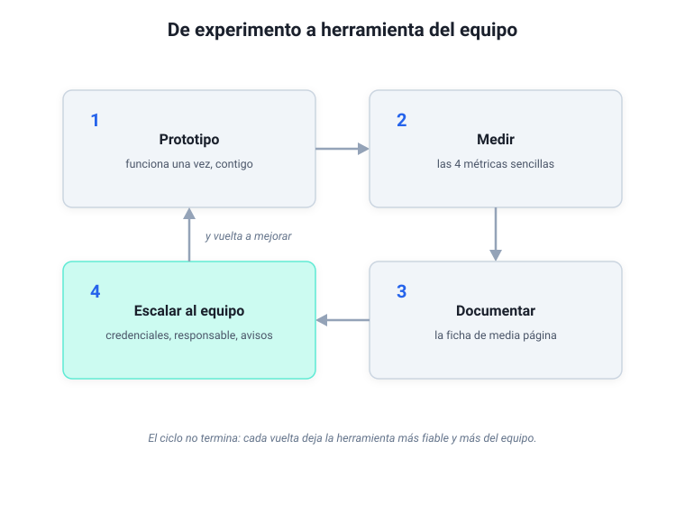

# Módulo 7 - Evaluar y escalar

## De "mi prototipo" a "herramienta del equipo"

Tenía un flujo que daba por sentado, y un día dejó de devolver resultados: el proveedor había cambiado la puerta por la que el flujo le pedía trabajo al modelo (técnicamente, la API), y nadie se enteró hasta que alguien preguntó por qué ya no llegaba el resumen. Así aprendí, por las malas, que el mantenimiento aburre y que es justo lo que separa un experimento de una herramienta en la que el equipo confía.

Este módulo trata de esa parte menos llamativa: **que lo que construyas funcione todos los días, para más gente y sin sustos**. Eso es escalar, en este curso: pasar de tu uso personal al de tu equipo. Si aún no has montado nada, evalúa lo que ya usas (un prompt que reutilizas cada semana, un GPT o un proyecto con tus documentos, un agente de Copilot de tu empresa): se prueba, se mide y se mantiene igual que un flujo.

El camino es un ciclo de cuatro pasos:

---

## 1. Pruebas: lista de comprobación para flujos y asistentes

Cada vez que cambies un prompt, una conexión, un documento o una credencial, pasa por esta lista (el curso recuerda lo que marques):

**Entrada:**

- [ ] El flujo sigue recibiendo el dato (correo, formulario, aviso de otra aplicación).
- [ ] La conexión sigue autorizada (no ha caducado la cuenta).
- [ ] Los filtros funcionan (no envía a la IA contenido que no debería).

**Procesamiento IA:**

- [ ] La IA responde en el idioma correcto.
- [ ] Devuelve el formato esperado (lista, párrafo, JSON).
- [ ] Responde algo razonable con un caso real.
- [ ] Ante una pregunta que no puede responder, lo indica en vez de inventar.

**Salida:**

- [ ] El resultado llega al canal o equipo correcto.
- [ ] Se guarda en el sistema previsto (hoja de cálculo, canal de Teams, el programa de clientes de la empresa, el CRM).
- [ ] Se ve quién o qué lo ha generado (trazabilidad mínima).

**Errores:**

- [ ] Si la IA falla, el flujo no se queda colgado sin avisar.
- [ ] Existe algún sitio donde se ve el error (un registro, un correo de aviso, el historial de la plataforma).

> [!warning] Alerta de privacidad
> Al probar, usa datos de ejemplo o anonimizados. No envíes datos reales de clientes a través de un flujo que todavía estás depurando: un error de configuración podría enviar información sensible a un canal equivocado.

Cuando el flujo ya funciona, esta lista puede convertirse en pruebas de regresión (comprobaciones automáticas de que lo que funcionaba ayer sigue funcionando tras un cambio) que corran solas cada madrugada con datos de ejemplo. Es un buen encargo para el asistente de código del [módulo 5](modulo-5-ia-que-programa.md).

Lo que sale hacia un cliente pide además verificación punto por punto, cifra a cifra, venga de un flujo o del chat: y es la primera norma que conviene dejar clara en cualquier equipo que empiece a usar la IA.

---

## 2. Cuatro métricas sencillas que demuestran valor

No necesitas un panel de control: con cuatro métricas sabes si tu caso de uso merece seguir vivo y puedes justificarlo ante dirección.

1. **Uso.** ¿Cuántas ejecuciones ha tenido esta semana, y quién lo usa de verdad? Si nadie lo usa, da igual lo sofisticado que sea.
2. **Ahorro de tiempo estimado.** Lo que tardabas antes en la tarea, multiplicado por las veces que la hace ahora la IA.
3. **Calidad percibida.** ¿Quien recibe el resultado lo usa o lo ignora? Basta una miniencuesta: "¿Te sirve tal como llega?": Sí / No / A medias.
4. **Errores o reintentos.** ¿Cuántas veces falla por credenciales caducadas, formatos inesperados o cambios en el modelo?

> [!tip] Observación práctica
> Mide el impacto en el proceso, que es lo que convence: "el flujo procesó 46 correos la semana pasada" es un dato técnico; "el equipo comercial ya no dedica 4 horas semanales a leer correos del cliente" es un dato de negocio.

Cuando el sistema madura, conviene medir también su **autonomía**: cuántas actuaciones completa sin que intervengas, cuántas correcciones necesita y qué capacidades nuevas gana. Es la medida de cuánto has subido por los niveles de delegación del apartado siguiente.

Si en tu empresa te piden demostrar que la IA te sirve de algo, lleva estas métricas aplicadas a una sola tarea: cuánto tardabas, cuánto tardas ahora, cada cuánto la haces y, si lo tienes, un error que tu revisión cazó a tiempo.

---

## 3. Delegar con control

La primera vez que se abre el correo a la IA da vértigo, y es la reacción sensata: en cuanto puede leer tu correo y tocar tus carpetas, la pregunta es cuánta libertad le das, y en qué tareas. Hay cuatro niveles de delegación:

1. **Solo lee.** Busca, resume y te cuenta lo que encuentra.
2. **Propone y tú decides.** Prepara el borrador o la respuesta, y tú apruebas.
3. **Ejecuta pidiendo confirmación.** Hace la acción después de preguntarte: "¿lo envío?".
4. **Ejecuta sola.** Actúa y te informa después.

El nivel se decide tarea a tarea, según lo que está en juego si sale mal:

| Sensibilidad de la tarea | Hasta qué nivel |
|--------------------------|-----------------|
| Baja: interna y reversible (ordenar o etiquetar tus propios archivos) | 4, cuando lleve semanas sin fallar |
| Media: sale con tu nombre o llega a un cliente | 2 o 3 |
| Alta: datos personales o confidenciales, o algo sin vuelta atrás (borrar, pagar, presentar) | 1 o 2 |

Las tres preguntas de privacidad del [módulo 1](modulo-1-entender-ia-generativa.md#la-decision-en-tres-preguntas) deciden qué material puede leer la IA; los niveles, qué puede hacer con él.

Para fijar el nivel ayuda escribir los permisos en negativo: lo que cada automatización tiene prohibido hacer. Preparar correos, sí; enviarlos, no, con una sola excepción acotada y escrita si de verdad hace falta. Mi prohibición de fondo la cuento en el [módulo 6](modulo-6-construir-sistema.md): nada sale con mi nombre sin pasar por mí. Y si la automatización lee material que escriben otros (correo, páginas web, archivos que te mandan), pesa además lo que conté en el [módulo 5](modulo-5-ia-que-programa.md#2-los-conectores-como-llega-la-ia-a-tu-correo-y-tus-carpetas): lo que lee puede traer instrucciones escondidas dirigidas a la IA, y esa automatización se queda en leer y proponer.

> [!note]- Profundiza: el nivel 4, una elección con condiciones (despliega)
> Hay sistemas que se corrigen a sí mismos: tus correcciones se convierten en reglas que el sistema incorpora solo si pasan las pruebas de regresión. Paco, mi sistema, propone el cambio y espera mi aprobación. Las dos posturas son razonables, y la primera pide tres condiciones: pruebas que corran antes de cada cambio, un registro de lo que hizo el sistema y alguien que lo lea. Si falta alguna, el nivel 3 es más prudente.

---

## 4. De "mi flujo" a "flujo del equipo"

Para que lo que hagas no se quede en tu cuenta personal:

1. **Centraliza credenciales.** Que la cuenta de la plataforma (Latenode, Power Automate, el espacio de proyectos de tu empresa) sea de equipo, para que el flujo sobreviva si cambias de puesto.
2. **Documenta en una página** qué hace, cuándo se ejecuta, qué entradas y salidas tiene, qué prompt usa (la versión exacta) y quién mantiene las credenciales. Y que haya una sola versión, la que todos usan.
3. **Define un responsable funcional**, técnico o no, que revise que el resultado siga siendo útil y que la gente lo use.
4. **Explica cómo avisar de un fallo:** "Si no te llega el resumen, avisa en este canal de Teams".

Si solo tú sabes cómo funciona, **todavía no está listo**; lo estará cuando otros puedan probarlo, usarlo y avisar de los fallos.

Cada tarea que resuelves bien con IA te deja un activo (un prompt, una plantilla, un asistente): guárdalo donde tu equipo lo encuentre y dejaréis de reinventar la rueda cada lunes. Para que la adopción crezca sirve una reunión corta con una sola pregunta, "¿qué te ha ahorrado tiempo esta semana?", en la que cada uno responde con un caso concreto y se lleva un patrón de un compañero para probarlo.

Para una organización hay también un motivo legal: el artículo 4 del Reglamento europeo de IA pide a las organizaciones que usan IA que pongan medidas para formar a su personal (el marco, en el [módulo 1](modulo-1-entender-ia-generativa.md#6-el-marco-legal-el-reglamento-europeo-de-ia)).

---

## 5. Cuándo pasarlo al equipo técnico

Pásalo cuando el volumen dispare los costes o los límites de la plataforma, cuando haya que entrar en sistemas internos con permisos especiales, guardar registros para auditoría o funcionar a todas horas sin caerse, o cuando la seguridad no admita una credencial personal.

> [!note]- Profundiza: la frase para el equipo técnico, y qué mirar si te pasan un repositorio (despliega)
> El vocabulario mínimo para esa conversación está en el bloque "El lenguaje de IT" del [glosario](glosario.md). Y una frase que puedes usar tal cual:
>
> "El caso de uso ya está validado en [Latenode, Power Automate o la plataforma que uses]. Necesitamos una versión más estable: un endpoint que haga esta operación, con credenciales centralizadas. Os paso el flujo, el prompt y los ejemplos de entrada y salida."
>
> Con eso has hecho tu parte, y el técnico tiene lo que necesita para actuar. Si es el equipo técnico quien te pasa un repositorio de GitHub, te basta con leer su documentación:
>
> 1. **`README.md`** → explica qué hace, cómo se instala, cómo se ejecuta.
> 2. **Carpeta `docs/` o ejemplos** → cómo se usa.
> 3. **`.env.example`** → qué credenciales hacen falta.
>
> Si puedes responder "qué hace", "qué datos de entrada pide" y "qué devuelve", ya puedes evaluar si es útil para tu caso.

---

## 6. Mantener los documentos y los prompts

Sin mantenimiento todo se rompe en silencio, como el flujo del principio, porque cambian los modelos, los documentos y las personas que lo usan.

**¿Y cuánto tiempo es, en la práctica?** Te doy mis datos, que para esto valen más que una teoría. Mi sistema es de los grandes (varios flujos, conectores, búsqueda propia) y aun así el mantenimiento activo es una revisión semanal de media hora: comprobar que las rutinas corrieron, hojear los registros, actualizar lo que cambió. A eso se suman las averías: en mis primeras 25 semanas conté cinco, cada una con su diagnóstico y su arreglo documentados, todas del estilo de la del principio del módulo (algo externo cambió y una pieza dejó de encajar).

Para un flujo o un asistente como los de este curso, el esfuerzo es menor: unos minutos a la semana de comprobar que corre y que el resultado sigue siendo útil, y asumir desde el principio que alguna vez al año algo se romperá y te pedirá una tarde. Como la herramienta no siempre avisa sola, añade tú un aviso que salte cuando algo falle (los ingenieros lo llaman [observabilidad](glosario.md)), para enterarte antes de que lo note el cliente.

**Reglas simples:**

- **Documento actualizado, asistente actualizado.** Si cambias el procedimiento, cambia el documento del asistente.
- **Versión visible** en el nombre del archivo: `2026-10-12 Procedimiento de acogida v3.pdf`.
- **Prompt documentado**, en su versión exacta y en un sitio compartido.
- **Un objetivo por prompt.** Si resume, que no traduzca y clasifique a la vez: eso multiplica las respuestas raras.
- **Instrucciones defensivas.** Dile al asistente qué hacer cuando la pregunta se sale de su tema o le falta información.
- **Señal de alerta.** Si la gente dice "ya no responde igual" o "ahora contesta cosas raras", revisa por este orden los documentos, el prompt y el modelo de la plataforma.

El curso se mantiene con ese mismo criterio, separando lo perecedero de lo perenne: los nombres de modelos, las versiones y los precios viven en un único cuadro fechado del [módulo 1](modulo-1-entender-ia-generativa.md) y en la página de [novedades](novedades.md); el método queda en los módulos.

---

## 7. Aplícalo

> [!example] Aplícalo
> Coge el flujo o el asistente que montaste (o, si aún no has montado nada, el prompt que más reutilizas) y escribe su ficha en media página: qué hace, cuándo se ejecuta, qué prompt usa, quién mantiene las credenciales, a quién se avisa si falla, en qué nivel de delegación trabaja y qué tiene prohibido hacer. Si no eres capaz de rellenarla, ahí tienes el trabajo pendiente antes de enseñárselo a nadie.

---

## Autoevaluación

> [!question] Comprueba lo que te llevas
> Respóndete a estas tres y despliega para comprobar.
>
> 1. Nombra dos de las cuatro métricas sencillas, y la que conviene añadir cuando el sistema madura.
> 2. Tu asistente prepara respuestas a clientes. ¿En qué nivel de delegación lo pondrías, y qué le prohibirías?
> 3. ¿Cuánto mantenimiento pide, en la práctica, un flujo o un asistente como los de este curso?

> [!note]- Soluciones
> 1. Dos de estas cuatro: **uso**, **ahorro de tiempo estimado**, **calidad percibida** y **errores o reintentos**. Cuando madura, la **autonomía**: cuántas actuaciones completa sin que intervengas y cuántas correcciones necesita.
> 2. En el **2** (propone y tú decides) o, como mucho, en el **3** (ejecuta pidiendo confirmación), porque lo que hace llega a un cliente. La prohibición: **preparar respuestas, sí; enviarlas, no**.
> 3. **Unos minutos a la semana** de comprobar que corre y sigue siendo útil, más asumir que alguna vez al año algo se romperá y te pedirá una tarde.

---

## 8. Cierre y aprendizajes clave

- **Cuatro métricas sencillas** demuestran valor sin montar un panel de control; cuando el sistema madura, mide su **autonomía**.
- **Delegar con control** es elegir un nivel por tarea, según lo que está en juego, y dejar escrito lo que cada automatización tiene prohibido.
- **Documentar, centralizar credenciales y nombrar un responsable** convierte "mi flujo" en "flujo del equipo".

> [!abstract] Resumen del módulo
> Sabes probar, medir y mantener un caso de uso de IA, decidir cuánta libertad darle y llevarlo de tu cuenta al equipo, o al equipo técnico cuando haga falta.

---

> [!info] Para profundizar
> - [Keep Your AI Projects on Track: Harvard Business Review](https://hbr.org/2023/11/keep-your-ai-projects-on-track): por qué fracasan los proyectos de IA y qué distingue a los que salen bien.
> - [Promptfoo](https://www.promptfoo.dev/): herramienta para probar aplicaciones de IA, de la calidad de las respuestas a los fallos de seguridad.

---

En el [Módulo 8](modulo-8-caso-uso-final.md) lo juntas todo en tu propio caso de uso: una ficha completa, con un ejemplo ya rellenado al lado, y una ruta de 30 días para pasar del papel a la práctica.
