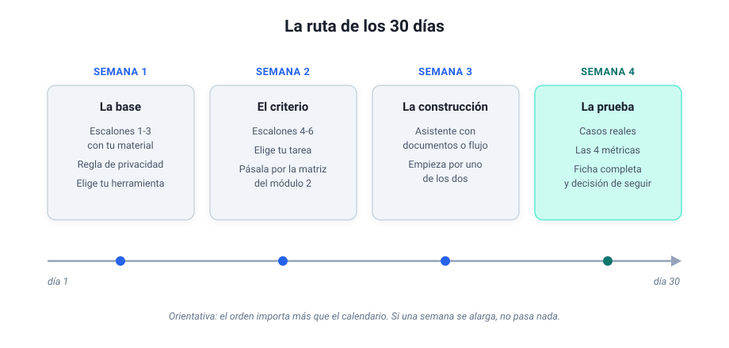

# Módulo 8 - Tu caso de uso

## Diseñar, documentar y ejecutar tu propio proyecto

Este es el módulo de cierre, y es puro trabajo de mesa: una ruta de 30 días para pasar del papel a la práctica y una ficha para que diseñes tu propio caso de uso de principio a fin (con lo necesario para ponerlo en marcha tú mismo o entregarlo a un equipo técnico).

---

## Tu ruta de 30 días

Esta ruta es el recorrido del curso convertido en calendario, para quien prefiere avanzar con hitos a la vista. Cada semana termina con algo comprobable, y la regla de oro es no saltarse el orden: las dos primeras semanas no usan más herramienta que el chat, y son las que hacen fáciles las dos últimas. Si llegas aquí desde [Antes de empezar](antes-de-empezar.md), quédate de momento con la ruta; el resto del módulo te espera en la semana 2, cuando elijas tu tarea.



- **Semana 1, la base.** Los tres ejercicios de "Antes de empezar" sobre material tuyo, la regla de privacidad en tres preguntas y la elección de herramienta (en muchas empresas ya está hecha: Copilot). Hito: una tarea real resuelta con una instrucción estructurada e iterada.
- **Semana 2, el criterio.** Los escalones 4 a 6 (encadenar, adjuntar, formatos) y la elección de tu tarea candidata, pasada por la matriz del módulo 2. Apunta ya su línea de base en la ficha de más abajo: cuánto tardas hoy y cada cuánto la haces. Hito: la tarea elegida, dibujada en tres cajas y con veredicto de "merece la pena".
- **Semana 3, la construcción.** El asistente con documentos del módulo 3 o el primer flujo del módulo 2, uno de los dos; ambos a la vez es la receta clásica del abandono. Si es un asistente, deja antes sus documentos en una sola versión válida, como propone el módulo 4. Hito: funciona una vez de principio a fin.
- **Semana 4, la prueba.** Casos reales, las cuatro métricas del módulo 7, la prueba de cinco preguntas del módulo 3 si es un asistente, y la ficha completa. Hito: la decisión de seguir, ajustar o parar, tomada con datos y con lo que apuntaste al principio en «sigo o lo dejo».

---

## Tu ficha de caso de uso

La ficha reúne en una página lo que hace falta para poner en marcha tu caso de uso o entregárselo a quien vaya a montarlo. No hace falta que salga perfecta al primer intento: es un documento vivo que irás refinando.

Hay tres líneas que conviene rellenar antes de construir nada. La **línea de base** es cuánto tardas hoy en la tarea y cada cuánto la haces: si no la apuntas ahora, al final no tendrás con qué comparar. **Qué no hace nunca sin ti** marca la frontera que la herramienta no cruza aunque pudiera (en mi sistema, ningún correo sale sin que yo lo envíe). Y **sigo o lo dejo** es lo que tendría que pasar durante la prueba para que sigas usándolo, y lo que te haría abandonarlo; apúntalo al principio, cuando todavía no le has cogido cariño al invento.

En la primera pestaña tienes la ficha de mi resumen de boletines del [módulo 2](modulo-2-automatizar-con-ia.md), ya rellenada; en la segunda, la plantilla en blanco, que copias con el botón del recuadro y pegas en un documento tuyo.

=== "Ejemplo: mi resumen de boletines"

    - **Nombre:** resumen matutino de boletines.
    - **Propósito:** leer cada mañana varios boletines y alertas de noticias, descartar el ruido y quedarme con lo relevante para infraestructuras.
    - **Destinatario:** yo, antes de desayunar.
    - **Línea de base:** unos 20-30 minutos cada mañana, todos los días, leyendo los boletines a mano.
    - **Patrón de IA:** clasificar (lo relevante frente al ruido) y resumir.
    - **Entrada:** los correos de las últimas 24 horas de una cuenta personal donde solo entran boletines públicos.
    - **Qué hace la IA:** un paso previo quita firmas, avisos legales y cabeceras repetidas; después ChatGPT recibe un prompt fijo: quedarse con lo relevante para infraestructuras, ordenarlo, resumirlo en una lista breve y decir si no hay nada que destacar.
    - **Salida:** un correo a mi dirección con la lista.
    - **Restricciones:** solo material público; ni correo de trabajo ni nada de clientes.
    - **Qué no hace nunca sin ti:** escribir a otra persona o leer otra cuenta que la de los boletines.
    - **Nivel de delegación:** ejecuta sola, porque solo lee material público y la única persona a la que escribe soy yo; con correo de clientes de por medio se quedaría en proponer, como el triaje de correo del módulo 6.
    - **Herramientas y accesos:** Latenode, una credencial del proveedor de IA y la autorización para que la plataforma lea esa cuenta de correo.
    - **Coste al mes:** menos de 50 céntimos de modelo; en plan gratuito de la plataforma, ese es todo el coste.
    - **Hábito:** corre solo cada mañana y lo reviso al leerlo; si falla del todo, lo noto enseguida, porque esa mañana no hay resumen. De mantenimiento, un vistazo de vez en cuando: la plataforma ya ha marcado un par de bloques como obsoletos, y el flujo sigue funcionando.
    - **Responsable:** yo.
    - **Métricas:** uso, una ejecución al día; ahorro, la línea de base menos los minutos que tardo en leer el resumen; calidad, si el resumen me basta o tengo que abrir los boletines; errores, las mañanas sin resumen o con el formato roto.
    - **Sigo o lo dejo:** sigo si me ahorra tiempo cada mañana y no se me escapa nada importante; lo dejo si empiezo a enterarme por otro lado de noticias que el resumen no traía.

=== "Tu ficha en blanco"

    ```text
    FICHA DE CASO DE USO

    Nombre:
    Propósito (qué problema resuelve, en una frase):
    Destinatario (quién usa el resultado):
    Línea de base (cuánto tardas hoy y cada cuánto lo haces):

    Patrón de IA (resumir, clasificar, extraer, conversar):
    Entrada (de dónde vienen los datos, en qué formato, cada cuánto):
    Qué hace la IA (con qué herramienta: tu chat, Copilot, un asistente
    con documentos o un flujo; y el prompt completo, con rol, formato,
    idioma y qué hacer si falta información):
    Salida (dónde se entrega y en qué formato):

    Restricciones (qué datos no pueden pasar por la IA; quién puede
    ver el resultado):
    Qué no hace nunca sin ti:
    Nivel de delegación (solo lee / propone y tú decides / ejecuta
    pidiendo confirmación / ejecuta sola):

    Herramientas y accesos (plataforma, plan, cuentas, credenciales):
    Coste al mes (suscripción y uso) frente a horas ahorradas al mes:
    Hábito (cuándo corre, quién revisa, cuánto mantenimiento asumes,
    cómo te enteras si falla):
    Responsable (quien vigila que siga sirviendo):

    Métricas (uso, ahorro, calidad, errores aceptables):
    Sigo o lo dejo (cuánto dura la prueba; sigo si...;
    lo dejo si...):
    ```

Para rellenar cada línea tienes el curso a mano: los precios, en el cuadro de versiones y precios del [módulo 1](modulo-1-entender-ia-generativa.md); los niveles de delegación, las cuatro métricas y el mantenimiento, en el [módulo 7](modulo-7-evaluar-y-escalar.md).

---

## La ficha para informática

Si lo que montaste tiene que pasar al equipo técnico, tu ficha ya contiene casi todo lo que van a necesitar, y la IA puede pasarla al formato que te pidan:

```text
Esta es la ficha de un caso de uso que quiero pasar al equipo de
informática. Conviértela en una ficha técnica de una página con
estos apartados: objetivo, cómo funciona hoy, qué datos maneja,
qué cuentas y credenciales usa, quién lo mantiene, qué pasa si
falla y qué necesito de ellos. Si un dato no está en la ficha,
márcalo como pendiente en vez de suponerlo.

[pega aquí tu ficha]
```

Si informática tiene su propia plantilla, pégala también y pide que la rellene con lo que dice tu ficha. Llegues con el formato que llegues, estas son las cuatro preguntas que te harán primero, y conviene llevarlas contestadas:

1. ¿Qué datos toca? De dónde salen, si hay datos personales o de clientes y por dónde viajan (las tres preguntas del módulo 1, dichas en su idioma).
2. ¿Con qué cuentas funciona? Si corre con tu cuenta personal o con una de equipo, y dónde se guardan las credenciales.
3. ¿Quién lo mantiene? Quién revisa que siga sirviendo y quién lo arregla cuando algo cambia por fuera.
4. ¿Qué pasa cuando falla? Quién se entera, cómo, y qué se hace mientras tanto.

Cuándo pasárselo y con qué frase, en el [módulo 7](modulo-7-evaluar-y-escalar.md#5-cuando-pasarlo-al-equipo-tecnico).

---

## Lleva un registro de tu propio avance

Una última idea, quizá la más fácil de pasar por alto. Lleva un registro de lo que vas construyendo y aprendiendo: qué probaste, qué funcionó, qué te atascó. No hace falta nada sofisticado: un archivo de texto basta, y la ficha de este módulo puede ser su primera página.

El salto de "uso ChatGPT" a "tengo un sistema que trabaja conmigo" se ve con meses de distancia, y para eso hacen falta las notas. Yo no me di cuenta de cuánto había avanzado hasta que un día leí mis propias notas de unos meses antes y no reconocí al que las había escrito.

---

> [!info] Para profundizar
> - [The GenAI Divide: State of AI in Business 2025: MIT NANDA](https://mlq.ai/media/quarterly_decks/v0.1_State_of_AI_in_Business_2025_Report.pdf) (copia en PDF; la dirección original ya no sirve): por qué el 95% de los pilotos de IA generativa en empresas no mostraba retorno medible.
> - [AI Index Report: Stanford HAI](https://hai.stanford.edu/ai-index): los datos anuales de referencia sobre la evolución de la IA en el mundo.
> - [What We Learned from a Year of Building with LLMs: O'Reilly](https://www.oreilly.com/radar/what-we-learned-from-a-year-of-building-with-llms-part-i/): lecciones de seis profesionales sobre lo que funciona y lo que no en producción.
> - [Ethan Mollick: One Useful Thing](https://www.oneusefulthing.org/): el blog más accesible y actualizado sobre el impacto real de la IA en el trabajo.

---

## Cuéntame cómo te ha ido

Si has llegado hasta aquí, tu experiencia es el dato que más me interesa: el curso mejora con lo que cuentan quienes lo han recorrido, y cada edición recoge esos arreglos en la página de [novedades](novedades.md). Son tres preguntas y una respuesta de cinco minutos por correo:

1. ¿Qué montaste (o intentaste montar)?
2. ¿Dónde te atascaste?
3. ¿Qué te faltó en el curso?

[Escríbeme la respuesta](mailto:jose@cordovilla.email?subject=Curso%20IA%3A%20mi%20experiencia&body=1%29%20Qu%C3%A9%20mont%C3%A9%20%28o%20intent%C3%A9%20montar%29%3A%0A%0A2%29%20D%C3%B3nde%20me%20atasqu%C3%A9%3A%0A%0A3%29%20Qu%C3%A9%20me%20falt%C3%B3%3A%0A%0A) (el enlace lleva las preguntas ya puestas). Leo todo lo que llega.

Y si quieres enterarte de las actualizaciones, [escríbeme](mailto:jose@cordovilla.email?subject=Curso%20IA%3A%20avisos%20de%20novedades) y te sumo a la lista de avisos. Si tu programa de correo no abre estos enlaces, escríbeme directamente a jose@cordovilla.email.

---

## Cierre del curso

Si has hecho los ejercicios, sabes ya pedirle trabajo a la IA y revisar lo que devuelve, sabes qué material puede pasar por ella, por qué herramienta y con qué permisos, y tienes una ficha de tu propio caso que puedes enseñar a tu jefe o entregar a informática tal cual. Para seguir al día cuando el curso se acabe no hace falta leerlo todo: con los cinco recursos del principio de la [página de recursos](recursos.md#si-solo-vas-a-mirar-cinco) y la página de [novedades](novedades.md) tienes de sobra.

> [!abstract] Cierre
> El resto es ponerse: si eliges una tarea que te duela, la montas y la mejoras semana a semana, tendrás entre manos lo mismo que tuve yo al principio. Así empezó Paco, el sistema con el que hoy trabajo cada día, y así empieza todo lo que en este curso te he contado.
